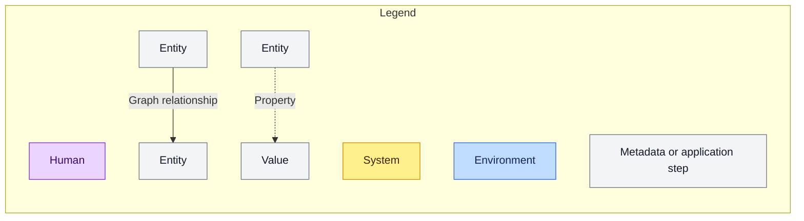
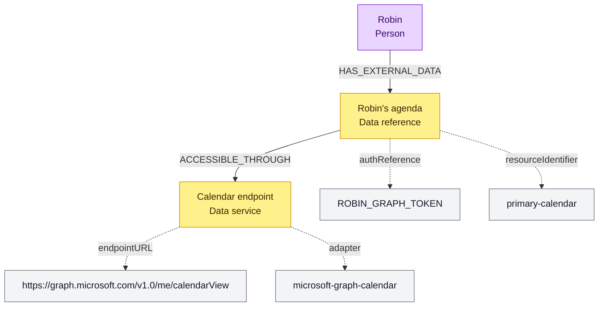
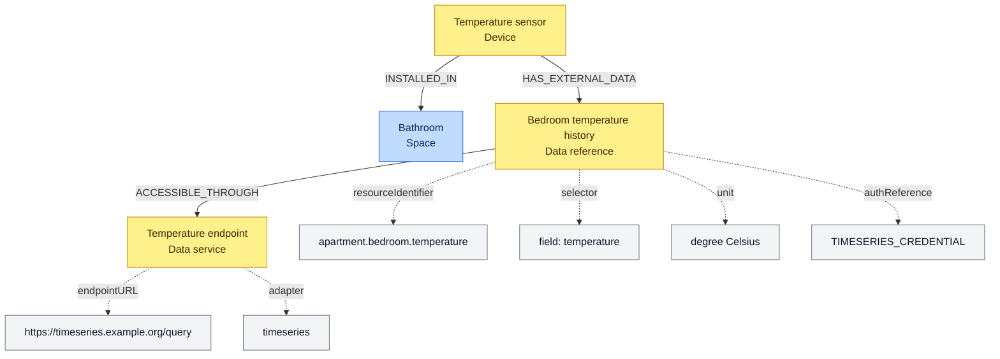
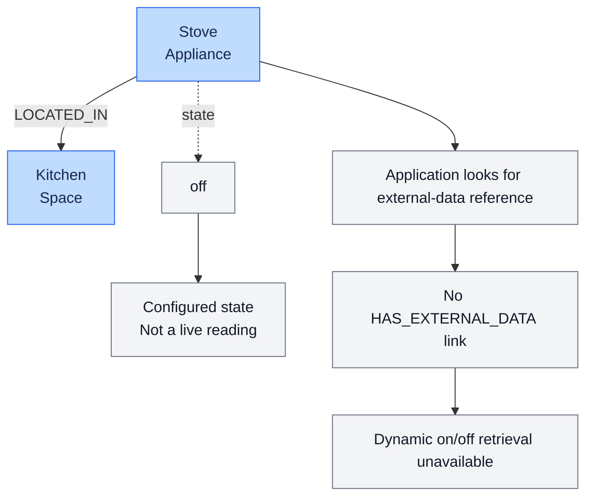

# Companion graph examples

These diagrams illustrate how graph entities can reference changing information
about the resident and home. They are not an implemented connector contract.
See the [companion architecture](companion-harness.md) for executable tool
scope and the [evaluation](../evaluations/companion-harness.md) for observations
from the actual import.

Connection metadata below illustrates the source graph, not information the
harness exposes to the model. The host resolves references against configured
supported sources. Fixed query implementations live in
[homeGraph.ts](../../apps/server/src/assistant/harness/homeGraph.ts); arbitrary
model-generated Cypher is not supported.

## Legend

## Agenda reference (unsupported connector)

Microsoft Graph calendar retrieval is not implemented. An endpoint and
authentication reference in the graph do not authorize account access.

## Bedroom temperature reference (conflicting metadata, unsupported adapter)

The sensor is linked to the bathroom, despite the bedroom reference name.
The illustrated time-series HTTP adapter is unsupported. Do not infer a live
bedroom measurement from this diagram.

## Kitchen appliance (configured state only)

A stove without an external-data reference has no supported live-state read.
Its graph state is a configured value, like other static properties, not an
observation. Keeping changing state outside the graph is the design direction;
the existing property must not be silently reinterpreted as current data.

