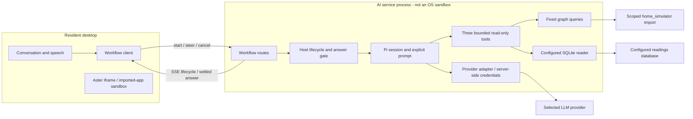
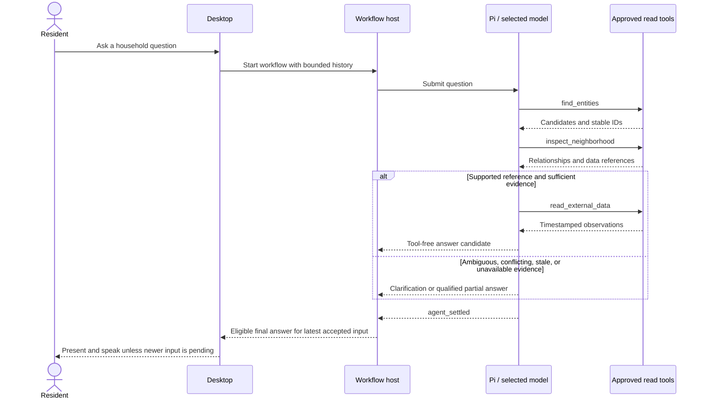
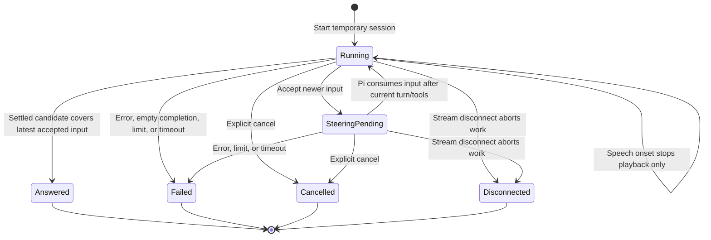

# Companion harness

Status: first implementation present; manually verified end to end for
household/resident questions; sensor readings and full acceptance pending.
The development-only developer audit is implemented; one-path convergence is
still planned.
Updated: 2026-11-05.

The opt-in Pi workflow investigates household questions through successive
read-only tool calls. It is a companion, not a coding agent. The architectural
decision and its trade-offs are in [ADR 0007](../adr/0007-companion-harness.md).
Configuration, route bodies, response codes, and local startup belong in the
[server guide](../../apps/server/README.md#companion-workflow-pi-harness).
Measured findings belong in the [evaluation](../evaluations/companion-harness.md);
remaining acceptance work and deferred ideas belong in
[task 0067](../../TASKS/0067-companion-harness.md) and its
[numbered follow-up tickets](../../TASKS/README.md#companion-investigation-harness).

## Turn mode versus workflow mode

These are two assistant execution paths in the same Sodalis AI server, not two
model providers or separately deployed agents. Both support ordinary
conversation, use the configured `LLM_PROVIDER`, and share the desktop's speech
input/output. Selecting workflow mode changes orchestration and capabilities;
it is **not yet a feature-complete replacement** for turn mode.

| Aspect | Turn mode | Workflow mode |
| --- | --- | --- |
| Intended use | Existing conversational desktop assistant, including registered app actions and optional memory. | Read-only household investigation whose next lookup depends on earlier evidence. |
| Runtime | Sodalis turn orchestration and its LLM provider adapter; no Pi loop. | Pi SDK embedded in the same AI process, controlled by Sodalis lifecycle and tool code; no Pi CLI or shell-script harness. |
| Reasoning over tools | Generates a structured utterance with an optional desktop action. Action results are not fed back into a continuing model/tool loop. Optional memory recall can trigger a second generation. | Repeated model/tool iterations can discover entities, inspect relationships, and read configured observations before answering. It can also answer without tools. |
| Available context | Bounded conversation history, optional current app identity and registered semantic action descriptions; consent-governed recalled memory when enabled. No app document contents or DOM. | Bounded conversation history and evidence returned by three explicit home tools. No desktop app context/action registry, DOM, or long-term-memory retrieval. |
| Desktop actions | Supported through the trusted action registry. External-effect and destructive actions require exact-action confirmation. | Not supported. Selecting this mode does not grant Pi desktop or device-control authority. |
| Home graph and readings | No Pi home-investigation tools on this path. | `find_entities`, `inspect_neighborhood`, and `read_external_data`; fixed scoped queries and explicitly configured sources, read-only. Missing sources produce explicit unavailable results. |
| Long-term memory | Optional retrieval and recording under existing consent, health-consent, retention, and deletion policies. | Neither retrieves nor records long-term memory. Enabling the memory subsystem does not connect it to workflow conversations. |
| Working history | Short in-memory resident conversation; no automatic persisted conversation transcript. | Short in-memory resident conversation plus a fresh in-memory Pi session per workflow. Tool evidence stays within that workflow; no automatic Pi transcript archive. |
| Answer format and presentation | Streamed JSON utterance; the desktop progressively captions text, validates affect/gesture/interruptibility, and speaks the completed reply. | SSE lifecycle events and a settled plain-text answer. Intermediate model text and tool narration are not resident answers; no structured affect/gesture output. |
| New message during work | Cancels/replaces the active turn and starts another, except input handled by the pending-action confirmation flow. | Steers the active workflow. An answer must cover the latest accepted input; if work has already settled, the desktop starts a new workflow. |
| Speech barge-in | Stops playback and aborts the active turn. | Stops playback but keeps the investigation running. Answers arriving during a newer utterance are held until that utterance resolves. |
| Explicit cancellation | Cancels the active turn and speech. | Cancels the workflow and speech; disconnecting its stream also stops server work. |
| Transport | `POST /api/assistant/turns`, streamed text deltas containing the utterance JSON. | `POST /api/assistant/workflows`, SSE `started` plus one terminal outcome; separate steer and cancel requests. |
| Execution bounds | Existing turn validation, response limits, and concurrency controls. | Host-enforced model/tool/steering budgets and timeouts; see [runtime limits](#runtime-details-and-limits). |

### Selecting and switching modes

- `COMPANION_HARNESS=off` (or unset) selects turn mode; `pi` selects workflow
  mode. The standard `.env.example` selects `pi`, with the simulator's graph
  URL, user, database, and scope prefilled; supply your own graph password.
  Unset remains `off` for compatibility. Other values fail configuration validation.
- The desktop reads `GET /api/assistant/config` at startup. The response is
  `{mode: "turn"}` or `{mode: "workflow"}`, without provider settings or
  credentials. The same built desktop supports either mode.
- To switch a Compose deployment, edit the ignored root `.env` or its selected
  overlay, restart with `pnpm stack:up`, and reload open desktop tabs. Clear
  graph/data settings when switching to `off`; those settings require `pi`.
  There is no resident-facing mode toggle or automatic fallback.
- During discovery, conversation input is disabled. A discovery error is
  displayed instead of silently choosing a different mode; reload to retry.
- The existing turn endpoint remains registered when Pi is enabled; mode
  discovery selects the normal desktop path, not an access-control policy.
  Graph settings and an optional read-only SQLite mount are only needed for
  workflow investigation, not for ordinary conversation with Pi.

For example, "Help me reply to this email" needs turn mode's registered desktop
actions today. "What is the bedroom temperature?" can use workflow mode to find
the room, discover its sensor/data reference, and read a timestamped observation.
Neither mode gains arbitrary shell, filesystem, imported-app, or network
capabilities from a model response.

The paths remain separate to preserve existing desktop-action and memory
behavior while the read-only Pi investigation is evaluated. Bringing those
capabilities into Pi requires explicit implementation and policy work, not
simply changing the mode flag. Real-model reasoning quality and latency remain
acceptance work; see [task 0067](../../TASKS/0067-companion-harness.md).

### Planned execution-path target

The approved target is for the harness to become the only supported assistant
execution path after confirmed desktop actions, consent-governed memory, and
steering/interruption behavior reach parity. Until then, the current selector
and both paths remain as documented above. This target is not shipped behavior.
Tasks [0076](../../TASKS/0076-preserve-memory-in-harness.md),
[0077](../../TASKS/0077-preserve-confirmed-actions-in-harness.md),
[0078](../../TASKS/0078-verify-harness-steering.md), and
[0079](../../TASKS/0079-converge-on-harness-execution-path.md) track that
sequence. Email and calendar work, durable/recurring runs, and resident-visible
evidence are not prerequisites for convergence.

Implementation entry points are
[ConversationOrchestrator](../../packages/assistant/src/index.ts),
[WorkflowConversationOrchestrator](../../packages/assistant/src/WorkflowConversation.ts),
and the [server turn handler](../../apps/server/src/assistant/app.ts).
The workflow implementation is mapped below; existing
[action and memory policy details](#existing-turn-path-and-memory) still apply.

## Components and authority

There is deliberately no workflow-to-Aster action or DOM edge. Preserve Aster's
iframe isolation and the narrow `desktop-host` boundary: no imported app
content, DOM, or arbitrary globals are exposed. A future desktop-action bridge
must preserve [ADR 0003](../adr/0003-trusted-desktop-boundary.md).

Only explicitly configured sources and capabilities execute. Model output and
graph connection metadata grant no network or filesystem authority. Personal
email/calendar mutations and consequential actions require consent; no new
identity framework, device control, or personal-account connector is included.

### Module map

Paths below are relative to the repository root.

| Responsibility | Implementation |
| --- | --- |
| Session, explicit resources, prompt | [companionSession.ts](../../apps/server/src/assistant/harness/companionSession.ts), [prompt.ts](../../apps/server/src/assistant/harness/prompt.ts) |
| Provider compatibility | [companionModel.ts](../../apps/server/src/assistant/harness/companionModel.ts) |
| Lifecycle, steering, limits, answer gate | [workflow.ts](../../apps/server/src/assistant/harness/workflow.ts) |
| Tool schemas, descriptions, budgets | [tools.ts](../../apps/server/src/assistant/harness/tools.ts) |
| Neo4j access and bounded queries | [homeGraph.ts](../../apps/server/src/assistant/harness/homeGraph.ts) |
| Source-specific retrieval | [externalData.ts](../../apps/server/src/assistant/harness/externalData.ts) |
| HTTP transport and configuration | [routes.ts](../../apps/server/src/assistant/harness/routes.ts), [config.ts](../../apps/server/src/assistant/harness/config.ts) |
| Desktop workflow orchestration | [WorkflowConversation.ts](../../packages/assistant/src/WorkflowConversation.ts) |
| Desktop HTTP/SSE client | [ServerWorkflowClient.ts](../../packages/assistant/src/ServerWorkflowClient.ts) |

Database logic stays outside prompts and HTTP handlers. An adapter means
source-specific retrieval code, not a plugin system. No new workspace package,
general job queue, retry scheduler, or observability platform is required.

## Tools and evidence

The separate `home_simulator` project supplies the Neo4j import and external
references; it has no existing graph-read HTTP interface. These sources are not
automatically mapped to Sodalis's separate Home Assistant simulator. The harness
does not modify that project.

The source graph uses `Human`, `System`, `Environment`, and test `Scenario`
classes for people, systems, environments, and scenario metadata.
The harness exposes only its allowed scoped subset. Stable graph knowledge and
changing observations are distinct: a reference explains where to obtain data,
not what that source currently says. Existing appliance-state properties are
configured values, not live readings.

| Tool | Purpose and contract |
| --- | --- |
| `find_entities` | Resolve names/types into stable candidate IDs with disambiguating context; optional supported kind filter. |
| `inspect_neighborhood` | Inspect selected IDs with bounded depth and relationship filters; return related entities and external-data references, including `readable`. |
| `read_external_data` | Resolve a discovered reference ID on the server; optionally read a time range of at most 48 hours. Return observations, timestamps, units, source reference, and `checkedAt`. |

The exact argument schemas and descriptions are maintained in
[tools.ts](../../apps/server/src/assistant/harness/tools.ts), not duplicated
here. Results distinguish `ok`, `not_found`, `ambiguous`, and `unavailable`;
truncation is explicit. Observations distinguish `current`, `stale`, and
`last_change`. Unexpected defects are logged and surfaced as explicit failures,
not empty successes. Credentials and connection details are not resident-facing.

Graph queries are fixed, parameterized, bounded, and run in read-mode
transactions within the configured import scope. No model-generated Cypher is
accepted. Health, personality, geography and interest records, service nodes,
geometry, and scenario bindings are excluded. Search uses words, prefixes, and
Dutch compounds over names, URI slugs, and types; equally good candidates can
produce `ambiguous`. Inspect the actual imported schema when changing queries;
diagram labels are not proof of deployed schema.

Only the simulator's configured SQLite `readings` series has a reader.
Time-series HTTP, Microsoft Graph calendar, SQLite agenda, and weather references
report `unavailable`. The model cannot supply arbitrary URLs, SQL, files, or
credentials. See [graph examples](companion-graph-examples.md) for illustrative
references, including unsupported connectors and conflicting metadata.

Equivalent calls reuse earlier results within a workflow; no results or whole
answers are cached across workflows. Repeated unproductive calls stop the
investigation. Stable metadata and changing source contents need separate
freshness policies before any future caching. A future agenda request must
fetch current contents, not reuse a previous answer.

## Investigation and answer delivery

The model chooses tools based on preceding results; Sodalis does not parse
planning prose, run a second classifier, or hardcode the lookup sequence.
Ordinary conversational questions need no tools.

This sequence is illustrative, not a fixture assertion or mandatory call order.
The [prompt](../../apps/server/src/assistant/harness/prompt.ts) is the
authoritative version-controlled instruction text. It asks for short plain-text
answers in the resident's language, treats retrieved content as data rather than
instructions, and requires:

- Investigate when facts or current measurements are needed; invent no entities
  or readings. Reuse suitable evidence already obtained.
- After a result, answer if sufficient; otherwise make another supported lookup
  if useful, ask for clarification if ambiguity matters, or explain a limitation.
- Do not repeat failed equivalent calls without a reason to expect change.
- Distinguish configured state from observations and stale from current data;
  use timestamps and units.
- Do not narrate internal planning, queries, or tool execution.

The host subscribes to SDK events before submitting input. Intermediate text and
tool results remain internal. Completed tool-free assistant messages from
`message_end` are answer candidates, not proof of sufficient evidence.
An answer is eligible only after `agent_settled`, with no cancellation,
terminal failure, or unprocessed accepted steering. `agent_end` alone is not
sufficient because recovery or queued work can follow.

The first implementation buffers the settled answer before speech. There is no
`respond_to_user` tool or extra model-based final-answer checker. Empty/error
completion produces an explicit failure; limit/timeout responses are short
host-authored Dutch messages without another model request. Acknowledgment and
progress are separate host/UI behavior, not evidence-backed model answers.

Resident responses give the conclusion and essential qualifications. Prefer
useful partial answers over invented completeness. A failed database request
does not establish that a sensor is offline. Detailed diagnostics stay in
developer logs; additional evidence may be explained on request, without a new
expandable evidence UI.

## Workflow lifecycle and races

One foreground workflow is allowed per resident conversation; a concurrent
start is refused with `409`. Each workflow gets a temporary in-memory session
with bounded conversation history. Accepted steering is retained in resident
conversation order, including input beyond the original question. Tool results
remain in that workflow and are not carried into unrelated future workflows.
Terminal completion disposes the session. Deliberately cancelled work does not
resume; there is no restart recovery.

These are conceptual states, not additional public events. While connected,
`started` is followed by at most one mutually exclusive terminal event:
`answer`, `failed`, or `cancelled`. Events carry `workflowId` and ordered
`sequence`; answers also identify the latest covered `inputId`. Internal tool
activity is not public. SSE is one-way, so steering/cancellation use separate
requests; exact wire contracts are in the [server guide](../../apps/server/README.md#companion-workflow-pi-harness).

Speech onset stops current and queued speech locally without closing the
workflow stream. Transcribed input steers the existing task. Native Pi steering
waits until the current assistant turn and tool calls finish; it is not immediate
concurrent processing. No separate interruption-classification model is used.
The existing turn path still aborts its turn on either interruption or explicit
cancellation; the stop-speech/steer distinction belongs to the workflow path.

Steering acceptance and finalization are serialized:

- Accepted-before-settlement input must be processed before an answer is
  published. Pi input not consumed before settlement is resubmitted in the same
  session; an older candidate is ineligible.
- If settlement wins, steering returns `not_running`. The desktop keeps the
  transcript and starts a new workflow after consuming the old terminal event,
  without dropping or double-submitting input. Input IDs support duplicates and
  conflict detection.
- An answer arriving during newer transcription/submission stays in history
  unspoken. It is spoken only if that utterance turns out empty.
- Explicit cancellation or stream disconnection aborts server work. Late
  callbacks/candidates cannot resume speech or contaminate a subsequent run.
  Disconnection cannot deliver a terminal event to the disconnected client.

## Runtime details and limits

The existing Compose AI container embeds Pi; there is no CLI subprocess or
separate Pi listener. `COMPANION_HARNESS=off|pi` is validated both by the stack
launcher and native startup. Neo4j remains externally managed. The AI container
also joins the Compose `graph` network (Docker name: the stack prefix), which
the Neo4j container is expected to join as host `neo4j`; no other service is on
it. The Sodalis stack creates that network, so it must start before an external
Neo4j that joins it; see the
[shared graph network](../development-stack.md#shared-graph-network). Optional
`HOME_DATA_SQLITE_FILE` readings are an explicit host-file bind mount, read-only
inside the AI container, never part of an image. The launcher checks the source
before restarting the stack, and a missing source cannot be auto-created by
Compose. See the [stack setup](../development-stack.md#companion-workflow-against-the-test-graph).

The desktop discovers `{mode: "turn"|"workflow"}` from
`GET /api/assistant/config` on startup, with caching disabled and a five-second
discovery timeout. The response exposes no credentials or provider settings.
Until discovery succeeds, no microphone controller is initialized; errors are
shown without silently selecting another mode. Reload after changing the
server selection or to retry a discovery failure.

Pi packages (`pi-coding-agent`, `pi-ai`, `pi-agent-core`) are pinned to 1.5.0.
The explicit resource loader uses in-memory session/settings managers and an
empty credential store. Default tools, local auth/model/settings files,
extensions, skills, prompt templates, context discovery, and transcript archives
are disabled. A system-prompt string is not a Pi slash-command prompt template.
Specialist skills/extensions are deferred unless a concrete need warrants them.

Pi 1.5 appends a `<cwd>` prompt section; the harness sets it to `/` rather than
adding a prompt-overriding extension. No file tools are exposed. Provider values
are escaped so Pi does not interpret literal credentials as `$VAR` or `!command`
templates.

The existing model settings map to Pi's `openai-completions` provider. Azure
receives both bearer and `api-key` authentication; reasoning effort maps to Pi's
thinking level, with `off` using a non-reasoning model. `mock` uses Pi's faux
provider. Answers are plain text, not the turn path's structured JSON utterance.
Credentials stay server-side; SDK compatibility must be rechecked on upgrades.

Current host bounds are 8 model responses, 16 tool calls, 8 steering inputs,
and 60 seconds per workflow; graph calls and external reads have 4-second
timeouts and Neo4j queries 3 seconds. Authoritative constants and repeat budgets
are in [workflow.ts](../../apps/server/src/assistant/harness/workflow.ts),
[tools.ts](../../apps/server/src/assistant/harness/tools.ts), and
[homeGraph.ts](../../apps/server/src/assistant/harness/homeGraph.ts). These
are implementation bounds, not resident settings or response-time guarantees.
Query plans are warmed at startup following the [cold-query findings](../evaluations/companion-harness.md#results).

### Observability gap

When `COMPANION_AUDIT=true`, `FileCompanionAuditWriter` appends one chronological
human-readable transcript and one structured JSONL record per event from the
same Pi event stream under repository-root `logs/`. The AI service's Compose
configuration bind-mounts `./logs` at `/app/logs`, so files survive container
shutdown. The default is off; startup rejects enabling it when `NODE_ENV` is
`production`. The server guide documents these settings.

The records include resident text messages, model/turn metadata and timing,
tool selection, dispatch and result (including names, arguments, validation
decisions and durations), accepted steering, correlation IDs, and the terminal
outcome. Only text content and explicit provider/model/usage metadata are
recorded; hidden chain-of-thought is never included. Speech input reaches this
workflow as a text transcript only; audio bytes, recordings and artifacts are
not captured. Credential-like keys and values are redacted before either file
is written.

This sensitive developer diagnostic remains out of resident UI, public SSE,
external uploads, and durable assistant memory. Developers manually delete
logs; no automatic expiry/deletion, capacity manager, warning UI, or retention
service is planned. Ordinary write errors use standard server error logging.
This intentionally supersedes the earlier planned constraint against
persistence beyond a developer session, narrowly for local development audit.
It does not change memory consent, retention, or deletion. The diagnostic has
no compliance-grade guarantees and adds no resident-facing runtime behavior.

## Planned acceptance roadmap

The audit task is implemented
([0068](../../TASKS/0068-persistent-developer-audit.md)). Next are
evidence-based diagnosis and bounded repair
([0069](../../TASKS/0069-diagnose-harness-data-retrieval.md)), then one
repeatable sensor journey
([0070](../../TASKS/0070-complete-sensor-journey.md)). The known cause of the
missing reading is not established.

Read-only email and calendar each require an independent access decision before
their journey tickets ([0071](../../TASKS/0071-decide-read-only-email-access.md),
[0072](../../TASKS/0072-complete-read-only-email-journey.md),
[0073](../../TASKS/0073-decide-read-only-calendar-access.md), and
[0074](../../TASKS/0074-complete-read-only-calendar-journey.md)). Memory policy
is decided before harness integration
([0075](../../TASKS/0075-decide-harness-memory-and-context.md),
[0076](../../TASKS/0076-preserve-memory-in-harness.md)); existing confirmed
actions and steering parity are separately tracked
([0077](../../TASKS/0077-preserve-confirmed-actions-in-harness.md),
[0078](../../TASKS/0078-verify-harness-steering.md)). Only the sensor journey,
memory integration, action parity, and steering verification block the planned
one-path convergence in task
[0079](../../TASKS/0079-converge-on-harness-execution-path.md).

Graph-test CI coverage and decisions on longer-lived work or resident-visible
progress/evidence are independent work
([0080](../../TASKS/0080-deterministic-graph-ci-coverage.md),
[0081](../../TASKS/0081-decide-longer-lived-work.md),
[0082](../../TASKS/0082-decide-resident-progress-and-evidence.md)). Latency
evaluation follows the sensor journey
([0083](../../TASKS/0083-evaluate-harness-latency.md)); no response-time target
is currently approved.

Implementation tickets update this architecture with current/planned behavior
and verification evidence. Architectural decisions and trade-offs belong in
ADRs; consolidated evaluation findings belong in
[`docs/evaluations/`](../evaluations/README.md).

## Existing turn path and memory

The desktop workflow path is opt-in and offers no app actions. Existing
[turn orchestration](../../apps/server/src/assistant/app.ts) retains optional
memory retrieval/recording through
[memoryConfig.ts](../../apps/server/src/assistant/memoryConfig.ts).
The workflow path neither retrieves nor records long-term memory.

[ADR 0005](../adr/0005-long-term-memory.md) defines SQLite authority, layered
memory, provenance, retention/deletion, top-level memory consent and separate
health consent, not per-item approval. Retrieval and asynchronous extraction
are separate. Connecting these policies to Pi context or compaction is
unresolved; resident conversation history is not that memory system.

The existing [assistant flow](../../packages/assistant/src/index.ts) executes
structured actions through
[AssistantActions.ts](../../packages/assistant/src/AssistantActions.ts), with
desktop-side exact-action confirmation. It does not return action results into
another model iteration. Moving actions into Pi requires a separate bridge and
must not weaken confirmations.

## Behavior-test map

These files are the evidence locations. They, `pnpm typecheck`, and `pnpm build`
passed on 2026-11-04 after consolidation; the direct graph integration test
skips without its local Neo4j settings.

| Guarantee | Behavior tests |
| --- | --- |
| Tool-result-driven continuation, settled-answer gate, steering, cancellation, limits | [workflow.test.ts](../../apps/server/src/assistant/harness/workflow.test.ts) |
| Audit correlation/lifecycle, text-only transcript, redaction, hidden-reasoning exclusion, write-error reporting | [workflow.test.ts](../../apps/server/src/assistant/harness/workflow.test.ts) |
| HTTP lifecycle, audit isolation from SSE and memory, configuration, literal provider values | [routes.test.ts](../../apps/server/src/assistant/harness/routes.test.ts) |
| Repository-root audit bind mount persistence | [companion-compose.test.ts](../../scripts/companion-compose.test.ts) |
| Bounded tool reads, explicit unavailable results, SQLite observations | [tools.test.ts](../../apps/server/src/assistant/harness/tools.test.ts) |
| Actual imported schema and supported source reads, without models; local only, against the `home_simulator` Neo4j test container | [homeGraph.integration.test.ts](../../apps/server/src/assistant/harness/homeGraph.integration.test.ts) |
| Speech-stop/steer distinction, in-transit answers, newer input | [WorkflowConversation.test.ts](../../packages/assistant/src/WorkflowConversation.test.ts) |
| HTTP/SSE transport | [ServerWorkflowClient.test.ts](../../packages/assistant/src/ServerWorkflowClient.test.ts) |
| Runtime mode discovery and explicit failures | [assistantMode.test.ts](../../packages/assistant/src/assistantMode.test.ts), [DesktopAvatarOverlay.test.ts](../../apps/desktop/src/avatar/DesktopAvatarOverlay.test.ts) |
| Validated stack selection and read-only Compose data wiring | [stack-config.test.ts](../../scripts/stack-config.test.ts), [companion-compose.test.ts](../../scripts/companion-compose.test.ts) |

Scripted models establish orchestration behavior, not real-model investigative
quality. Manual acceptance cases, unmeasured latency targets, and per-run cloud
consent requirements are in [task 0067](../../TASKS/0067-companion-harness.md).
