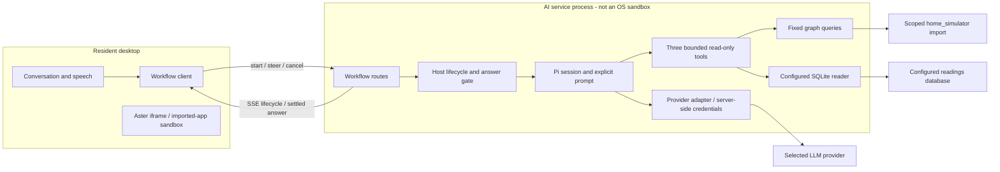
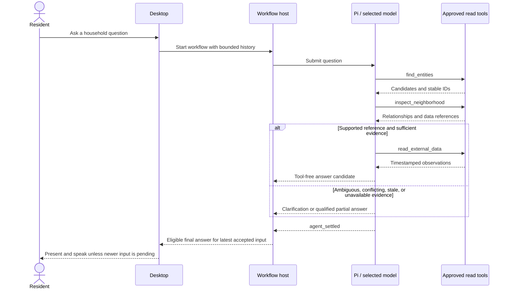
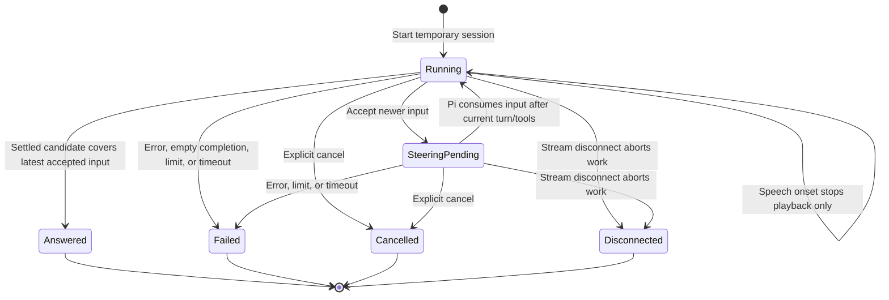

# Companion harness

Status: first implementation present; manually verified end to end for
household/resident questions; sensor readings and full acceptance pending.
The development-only developer audit is implemented; read-only email/calendar
adapters and one-path convergence are still planned.
Updated: 2026-11-05.

The opt-in Pi workflow investigates household questions through successive
read-only tool calls. It is a companion, not a coding agent. The architectural
decision and its trade-offs are in [ADR 0007](../adr/0007-companion-harness.md).
Configuration, route bodies, response codes, and local startup belong in the
[server guide](../../apps/server/README.md#companion-workflow-pi-harness).
Measured findings belong in the [evaluation](../evaluations/companion-harness.md);
remaining acceptance work and deferred ideas belong in
[task 0067](../../TASKS/0067-companion-harness.md) and its
[numbered follow-up tickets](../../TASKS/README.md#companion-investigation-harness).

## Turn mode versus workflow mode

These are two assistant execution paths in the same Sodalis AI server, not two
model providers or separately deployed agents. Both support ordinary
conversation, use the configured `LLM_PROVIDER`, and share the desktop's speech
input/output. Selecting workflow mode changes orchestration and capabilities;
it is **not yet a feature-complete replacement** for turn mode.

| Aspect | Turn mode | Workflow mode |
| --- | --- | --- |
| Intended use | Existing conversational desktop assistant, including registered app actions and optional memory. | Read-only household investigation whose next lookup depends on earlier evidence. |
| Runtime | Sodalis turn orchestration and its LLM provider adapter; no Pi loop. | Pi SDK embedded in the same AI process, controlled by Sodalis lifecycle and tool code; no Pi CLI or shell-script harness. |
| Reasoning over tools | Generates a structured utterance with an optional desktop action. Action results are not fed back into a continuing model/tool loop. Optional memory recall can trigger a second generation. | Repeated model/tool iterations can discover entities, inspect relationships, and read configured observations before answering. It can also answer without tools. |
| Available context | Bounded conversation history, optional current app identity and registered semantic action descriptions; consent-governed recalled memory when enabled. No app document contents or DOM. | Bounded conversation history and evidence returned by three explicit home tools. No desktop app context/action registry, DOM, or long-term-memory retrieval. |
| Desktop actions | Supported through the trusted action registry. External-effect and destructive actions require exact-action confirmation. | Not supported. Selecting this mode does not grant Pi desktop or device-control authority. |
| Home graph and readings | No Pi home-investigation tools on this path. | `find_entities`, `inspect_neighborhood`, and `read_external_data`; fixed scoped queries and explicitly configured sources, read-only. Missing sources produce explicit unavailable results. |
| Long-term memory | Optional retrieval and recording under existing consent, health-consent, retention, and deletion policies. | Neither retrieves nor records long-term memory. Enabling the memory subsystem does not connect it to workflow conversations. |
| Working history | Short in-memory resident conversation; no automatic persisted conversation transcript. | Short in-memory resident conversation plus a fresh in-memory Pi session per workflow. Tool evidence stays within that workflow; no automatic Pi transcript archive. |
| Answer format and presentation | Streamed JSON utterance; the desktop progressively captions text, validates affect/gesture/interruptibility, and speaks the completed reply. | SSE lifecycle events and a settled plain-text answer. Intermediate model text and tool narration are not resident answers; no structured affect/gesture output. |
| New message during work | Cancels/replaces the active turn and starts another, except input handled by the pending-action confirmation flow. | Steers the active workflow. An answer must cover the latest accepted input; if work has already settled, the desktop starts a new workflow. |
| Speech barge-in | Stops playback and aborts the active turn. | Stops playback but keeps the investigation running. Answers arriving during a newer utterance are held until that utterance resolves. |
| Explicit cancellation | Cancels the active turn and speech. | Cancels the workflow and speech; disconnecting its stream also stops server work. |
| Transport | `POST /api/assistant/turns`, streamed text deltas containing the utterance JSON. | `POST /api/assistant/workflows`, SSE `started` plus one terminal outcome; separate steer and cancel requests. |
| Execution bounds | Existing turn validation, response limits, and concurrency controls. | Host-enforced model/tool/steering budgets and timeouts; see [runtime limits](#runtime-details-and-limits). |

### Selecting and switching modes

- `COMPANION_HARNESS=off` (or unset) selects turn mode; `pi` selects workflow
  mode. The standard `.env.example` selects `pi`, with the simulator's graph
  URL, user, database, and scope prefilled; supply your own graph password.
  Unset remains `off` for compatibility. Other values fail configuration validation.
- The desktop reads `GET /api/assistant/config` at startup. The response is
  `{mode: "turn"}` or `{mode: "workflow"}`, without provider settings or
  credentials. The same built desktop supports either mode.
- To switch a Compose deployment, edit the ignored root `.env` or its selected
  overlay, restart with `pnpm stack:up`, and reload open desktop tabs. Clear
  graph/data settings when switching to `off`; those settings require `pi`.
  There is no resident-facing mode toggle or automatic fallback.
- During discovery, conversation input is disabled. A discovery error is
  displayed instead of silently choosing a different mode; reload to retry.
- The existing turn endpoint remains registered when Pi is enabled; mode
  discovery selects the normal desktop path, not an access-control policy.
  Graph settings and an optional read-only SQLite mount are only needed for
  workflow investigation, not for ordinary conversation with Pi.

For example, "Help me reply to this email" needs turn mode's registered desktop
actions today. "What is the bedroom temperature?" can use workflow mode to find
the room, discover its sensor/data reference, and read a timestamped observation.
Neither mode gains arbitrary shell, filesystem, imported-app, or network
capabilities from a model response.

The paths remain separate to preserve existing desktop-action and memory
behavior while the read-only Pi investigation is evaluated. Bringing those
capabilities into Pi requires explicit implementation and policy work, not
simply changing the mode flag. Real-model reasoning quality and latency remain
acceptance work; see [task 0067](../../TASKS/0067-companion-harness.md).

### Planned execution-path target

The approved target is for the harness to become the only supported assistant
execution path after confirmed desktop actions, consent-governed memory, and
steering/interruption behavior reach parity. Until then, the current selector
and both paths remain as documented above. This target is not shipped behavior.
Tasks [0076](../../TASKS/0076-preserve-memory-in-harness.md),
[0077](../../TASKS/0077-preserve-confirmed-actions-in-harness.md),
[0078](../../TASKS/0078-verify-harness-steering.md), and
[0079](../../TASKS/0079-converge-on-harness-execution-path.md) track that
sequence. Email and calendar work, durable/recurring runs, and resident-visible
evidence are not prerequisites for convergence.

Implementation entry points are
[ConversationOrchestrator](../../packages/assistant/src/index.ts),
[WorkflowConversationOrchestrator](../../packages/assistant/src/WorkflowConversation.ts),
and the [server turn handler](../../apps/server/src/assistant/app.ts).
The workflow implementation is mapped below; existing
[action and memory policy details](#existing-turn-path-and-memory) still apply.

## Components and authority

There is deliberately no workflow-to-Aster action or DOM edge. Preserve Aster's
iframe isolation and the narrow `desktop-host` boundary: no imported app
content, DOM, or arbitrary globals are exposed. A future desktop-action bridge
must preserve [ADR 0003](../adr/0003-trusted-desktop-boundary.md).

Only explicitly configured sources and capabilities execute. Model output and
graph connection metadata grant no network or filesystem authority. Personal
email/calendar mutations and consequential actions require consent; no new
identity framework, device control, or personal-account connector is currently
implemented. The approved read-only email access design below is planned, not
runtime authority.

### Module map

Paths below are relative to the repository root.

| Responsibility | Implementation |
| --- | --- |
| Session, explicit resources, prompt | [companionSession.ts](../../apps/server/src/assistant/harness/companionSession.ts), [prompt.ts](../../apps/server/src/assistant/harness/prompt.ts) |
| Provider compatibility | [companionModel.ts](../../apps/server/src/assistant/harness/companionModel.ts) |
| Lifecycle, steering, limits, answer gate | [workflow.ts](../../apps/server/src/assistant/harness/workflow.ts) |
| Tool schemas, descriptions, budgets | [tools.ts](../../apps/server/src/assistant/harness/tools.ts) |
| Neo4j access and bounded queries | [homeGraph.ts](../../apps/server/src/assistant/harness/homeGraph.ts) |
| Source-specific retrieval | [externalData.ts](../../apps/server/src/assistant/harness/externalData.ts) |
| HTTP transport and configuration | [routes.ts](../../apps/server/src/assistant/harness/routes.ts), [config.ts](../../apps/server/src/assistant/harness/config.ts) |
| Desktop workflow orchestration | [WorkflowConversation.ts](../../packages/assistant/src/WorkflowConversation.ts) |
| Desktop HTTP/SSE client | [ServerWorkflowClient.ts](../../packages/assistant/src/ServerWorkflowClient.ts) |

Database logic stays outside prompts and HTTP handlers. An adapter means
source-specific retrieval code, not a plugin system. No new workspace package,
general job queue, retry scheduler, or observability platform is required.

## Tools and evidence

The separate `home_simulator` project supplies the Neo4j import and external
references; it has no existing graph-read HTTP interface. These sources are not
automatically mapped to Sodalis's separate Home Assistant simulator. The harness
does not modify that project.

The source graph uses `Human`, `System`, `Environment`, and test `Scenario`
classes for people, systems, environments, and scenario metadata.
The harness exposes only its allowed scoped subset. Stable graph knowledge and
changing observations are distinct: a reference explains where to obtain data,
not what that source currently says. Existing appliance-state properties are
configured values, not live readings.

| Tool | Purpose and contract |
| --- | --- |
| `find_entities` | Resolve names/types into stable candidate IDs with disambiguating context; optional supported kind filter. |
| `inspect_neighborhood` | Inspect selected IDs with bounded depth and relationship filters; return related entities and external-data references, including `readable`. |
| `read_external_data` | Resolve a discovered reference ID on the server; optionally read a time range of at most 48 hours. Return observations, timestamps, units, source reference, and `checkedAt`. |

The exact argument schemas and descriptions are maintained in
[tools.ts](../../apps/server/src/assistant/harness/tools.ts), not duplicated
here. Results distinguish `ok`, `not_found`, `ambiguous`, and `unavailable`;
truncation is explicit. Observations distinguish `current`, `stale`, and
`last_change`. Unexpected defects are logged and surfaced as explicit failures,
not empty successes. Credentials and connection details are not resident-facing.

Graph queries are fixed, parameterized, bounded, and run in read-mode
transactions within the configured import scope. No model-generated Cypher is
accepted. Health, personality, geography and interest records, service nodes,
geometry, and scenario bindings are excluded. Search uses words, prefixes, and
Dutch compounds over names, URI slugs, and types; equally good candidates can
produce `ambiguous`. Inspect the actual imported schema when changing queries;
diagram labels are not proof of deployed schema.

Only the simulator's configured SQLite `readings` series has a reader.
Time-series HTTP, Microsoft Graph calendar, SQLite agenda, and weather references
report `unavailable`. The model cannot supply arbitrary URLs, SQL, files, or
credentials. See [graph examples](companion-graph-examples.md) for illustrative
references, including unsupported connectors and conflicting metadata.

Equivalent calls reuse earlier results within a workflow; no results or whole
answers are cached across workflows. Repeated unproductive calls stop the
investigation. Stable metadata and changing source contents need separate
freshness policies before any future caching. A future agenda request must
fetch current contents, not reuse a previous answer.

### Approved read-only calendar contract (planned)

[Task 0073](../../TASKS/0073-decide-read-only-calendar-access.md) selects one
provider-neutral calendar interface with **both Microsoft Graph and Google
Calendar adapters in the initial implementation**. Neither adapter nor account
authorization is implemented today; [task 0074](../../TASKS/0074-complete-read-only-calendar-journey.md)
implements and verifies this contract. This specializes ADR 0007's existing
host-controlled read capability, without changing its architectural decision.

The seam is a server-owned `readCalendar` operation behind the harness's
explicit read tools, not arbitrary HTTP access or an imported desktop calendar.
Both adapters satisfy the same interface and acceptance cases. Provider OAuth,
pagination, recurrence expansion, and timezone conversion stay inside the
calendar module. No generic connector registry or new identity framework is
required.

#### Question, interval, and source

The first journey is: **"What appointments are in my selected calendar
tomorrow?"** It reads exactly one explicitly selected, authorized source:
the signed-in account's default Microsoft calendar or Google `primary`
calendar. A host-owned opaque source reference binds resident, provider,
account subject, and calendar; the model cannot supply account IDs, calendar
IDs, endpoints, scopes, or credentials. Graph references can help discover that
source but never establish account ownership or consent. No configured source
means unavailable; multiple eligible sources require clarification, not a
silent default or a combined answer.

- Resolve "tomorrow" against a captured request clock in the resident's
  explicitly configured IANA timezone. If that zone or source is missing or
  ambiguous, ask before fetching. Never infer the zone from server locale,
  provider defaults, or an email address.
- Use a half-open local-day interval `[midnight, next midnight)`, converted to
  UTC instants using timezone rules. A day can be 23 or 25 hours. Explicit
  periods must have valid ordered endpoints and span at most 48 elapsed hours;
  reject wider periods rather than silently narrowing them.
- Include timed events overlapping the interval (`start < queryEnd` and
  `end > queryStart`), including ongoing appointments. Expand recurring
  occurrences and exceptions, omit cancelled events, deduplicate occurrence
  IDs, and order by start then stable occurrence ID. Preserve an untitled
  appointment as such rather than inventing a title.
- Preserve all-day events as start/end **dates with exclusive end date** in
  their calendar timezone; do not fabricate midnight appointment times.
  Include them when that date span overlaps the requested interval after
  calendar-zone interpretation. Timed events retain UTC instants and render
  in the requested IANA zone with the applicable offset.
- An answer states the requested day/period, timezone, and selected provider
  and safe calendar label, with the time checked. "No appointments" is
  justified only by a complete, fresh, authorized empty result for that source
  and interval; it is not a claim about all of the resident's calendars.

#### Shared interface and normalized outcomes

The planned request carries `sourceRef`, UTC `start`/`end`, IANA `timeZone`,
and the captured clock; trusted caller authorization and cancellation are
host-supplied, never model-provided. Validate resident/source binding and the
interval before any network request, including reused within-workflow reads.

Every outcome identifies the safe source reference/provider/calendar label,
requested interval and zone, and `checkedAt` (attempt time, not evidence that
the provider answered). Successful evidence additionally records `fetchedAt`.
Events expose only an opaque occurrence reference, optional title, and timed
start/end or all-day date span/calendar zone. Do not return event bodies,
attendees, attachments, meeting links, tokens, raw responses, or connection
details. Treat titles as untrusted data, never tool instructions. Both adapters
normalize into these outcomes; do not equate transport success with usable
evidence:

| Outcome | Meaning and resident behavior |
| --- | --- |
| `ok` | Complete fresh result with one or more normalized appointments; source evidence accompanies each occurrence. |
| `empty` | Complete fresh result with zero appointments in the exact requested interval. |
| `unauthorized` | Missing/expired/revoked grant, wrong resident/account binding, insufficient permission, or provider 401/403 after at most one permitted refresh. Ask to connect/reconnect; return no events and never try another account. |
| `unavailable` | Source not configured, timeout, network/provider failure, rate limit, malformed data, incomplete pagination, or exceeded result budget. Explain that appointments could not be checked; return no partial list as a complete answer. |
| `stale` | Evidence is explicitly known to be out of date; label it with its original fetch time and do not claim current appointments or current emptiness. No persistent calendar cache is introduced in 0074, so a failed fresh fetch is normally unavailable, not stale. An old event modification timestamp alone does not mean stale evidence. |
| `invalid_request` / `ambiguous` | Invalid/over-wide interval or unresolved source/timezone; reject or ask for clarification without contacting a provider. |

These are calendar outcomes, not claims that the current external-data schema
already supports them. Task 0074 must preserve their meaning through tool
evidence and resident delivery, including a distinct empty versus failed read.
Bound each read to 100 expanded occurrences and five provider pages, within
the existing workflow tool timeout/cancellation budget. Fetch all pages before
claiming completeness; exceeding either cap is unavailable with an incomplete
reason, not empty or a silently truncated list. Do not follow provider-supplied
pagination URLs outside the configured provider origin and selected account/
calendar. Do not retry indefinitely; rate limiting remains an explicit failure.
Cancellation stops fetching and prevents a late result becoming an answer.
No cross-workflow result reuse or offline fallback is approved.

#### Delegated authorization and provider setup

Account access requires an explicit resident-initiated connection and provider
consent. A host-owned grant binds the authenticated resident to the provider's
verified stable account subject, exact selected calendar, granted scopes, and
expiry. Local source selection is not a substitute for provider consent, and
provider consent is not permission for another resident. Disconnect immediately
disables reads and removes locally held tokens; attempt provider revocation
where supported, without making local removal depend on network success.

Connection, callback validation, session binding, and disconnect follow the
shared [delegated account authorization](#delegated-account-authorization)
protocol, using calendar-only client registrations. The host handles exchange
and refresh; the assistant and Aster never receive codes, tokens, client
credentials, or authorization headers.

| Provider | Required setup and least read-only grant for this journey |
| --- | --- |
| Microsoft Graph | Register a Microsoft identity application for the intended tenant/account types and a server redirect URI; configure client ID, allowed tenant/issuer and client credential where the registration requires it. Request **delegated `Calendars.ReadBasic`**, not application permissions, `Calendars.ReadWrite`, or shared-calendar access. Add `openid` for verified account binding and `offline_access` only for refreshable consent. Use the signed-in user's default calendar through `GET /v1.0/me/calendarView`, explicit UTC `startDateTime`/`endDateTime`, and a minimal field selection (ID, subject, start, end, original timezone fields, all-day/cancelled flags). Request UTC for timed values rather than trusting its default zone; preserve original timezone information to recover all-day dates, mapping supported Windows zones to IANA. An unresolvable custom zone is unavailable, not a guessed date. Tenant policies may require administrator approval; report this as setup/authorization work, not permission to broaden scopes. |
| Google Calendar | Create a Google Cloud project, enable Calendar API, configure the OAuth consent screen (test users while in testing), and register a web OAuth client with exact server redirect URI. Request **`https://www.googleapis.com/auth/calendar.events.readonly`** plus `openid` for verified subject binding. Use `access_type=offline` only when refresh is needed; do not force consent on every read. Read only `GET /calendar/v3/calendars/primary/events` with `timeMin`/`timeMax`, `singleEvents=true`, `showDeleted=false`, and minimal response fields including pagination and calendar timezone. The grant can cover more calendars than this journey; host policy still restricts it to `primary`. No broad `calendar` write scope, service account, or domain-wide delegation. Public distribution may require OAuth verification; testing grants may expire and must not silently become empty results. |

Provider documentation for implementation:
[Graph calendarView](https://learn.microsoft.com/en-us/graph/api/calendar-list-calendarview?view=graph-rest-1.0),
[Microsoft delegated scopes](https://learn.microsoft.com/en-us/graph/permissions-reference#calendarsreadbasic),
[Google events.list](https://developers.google.com/workspace/calendar/api/v3/reference/events/list),
and [Google server-side OAuth](https://developers.google.com/identity/protocols/oauth2/web-server).
Task 0074 must check the actual registered-client requirements and consented
scopes; these links and endpoint metadata do not authorize any live request.

Keep client secrets and refresh/access tokens in host-only secure credential
storage (OS credential store or encrypted server store with its key separately
managed), never plaintext credential files in the repository. Ignored local
configuration may reference secret storage and contain non-secret client IDs,
issuer, redirect, timezone, and source aliases; commit only placeholders.
Document the concrete store and provisioning steps before enabling either
adapter; if secure storage is unavailable, fail closed. Never place secrets in
browser storage, URLs beyond the required OAuth callback, prompts, tool evidence,
developer audit, errors, fixtures, GitHub Actions, or distributed artifacts.
Redact callback query strings and token-exchange responses from request logs.
Refresh only for the bound account and approved scopes; if refresh fails,
require reconnection, with no silent permission expansion. No automatic
long-term-memory ingestion of calendar evidence is authorized.

#### Deterministic verification and exclusions

Use a shared synthetic fixture calendar and fixed clock, exercised through the
public calendar interface for both adapters and through the harness's evidence/
answer path. Provider-shaped synthetic HTTP responses sit at the injected
transport seam; use no real accounts, secrets, copied personal events, network,
or real-model assertions. The same expected normalized events must result from
Graph and Google payloads. Include timed/all-day/recurring/exception/cancelled
events, empty days, overlap boundaries, timezone offsets and DST, pagination,
and failures; [0074](../../TASKS/0074-complete-read-only-calendar-journey.md)
specifies acceptance fixtures. Only future implementation adds behavior tests;
0073 changes documentation alone.

Live verification is separate, opt-in, never CI, and self-skips without explicit
enablement or credentials. Use only a consenting user's dedicated synthetic
test calendar/account. Obtain explicit consent **for each run and each adapter**
before OAuth or calendar requests; account consent does not authorize an agent's
future live checks. Inspect `.env` and any `--env` overlay's selected providers
first; no incidental LLM, speech, or other cloud calls are authorized. Record
only sanitized setup, adapter, interval/zone, result class, and verification
limits, never tokens or personal appointments. This decision performs no live
verification.

Creating, editing, deleting, inviting, responding to events, subscription/watch
registration, background polling, shared/delegated calendars, calendar discovery,
and merging calendars are excluded. Do not combine appointments with email,
Home sensors, memory, or other sources to infer plans, availability, conflicts,
or recommendations. No writes, cross-source synthesis, or provider fallback.

## Investigation and answer delivery

The model chooses tools based on preceding results; Sodalis does not parse
planning prose, run a second classifier, or hardcode the lookup sequence.
Ordinary conversational questions need no tools.

This sequence is illustrative, not a fixture assertion or mandatory call order.
The [prompt](../../apps/server/src/assistant/harness/prompt.ts) is the
authoritative version-controlled instruction text. It asks for short plain-text
answers in the resident's language, treats retrieved content as data rather than
instructions, and requires:

- Investigate when facts or current measurements are needed; invent no entities
  or readings. Reuse suitable evidence already obtained.
- After a result, answer if sufficient; otherwise make another supported lookup
  if useful, ask for clarification if ambiguity matters, or explain a limitation.
- Do not repeat failed equivalent calls without a reason to expect change.
- Distinguish configured state from observations and stale from current data;
  use timestamps and units.
- Do not narrate internal planning, queries, or tool execution.

The host subscribes to SDK events before submitting input. Intermediate text and
tool results remain internal. Completed tool-free assistant messages from
`message_end` are answer candidates, not proof of sufficient evidence.
An answer is eligible only after `agent_settled`, with no cancellation,
terminal failure, or unprocessed accepted steering. `agent_end` alone is not
sufficient because recovery or queued work can follow.

The first implementation buffers the settled answer before speech. There is no
`respond_to_user` tool or extra model-based final-answer checker. Empty/error
completion produces an explicit failure; limit/timeout responses are short
host-authored Dutch messages without another model request. Acknowledgment and
progress are separate host/UI behavior, not evidence-backed model answers.

Resident responses give the conclusion and essential qualifications. Prefer
useful partial answers over invented completeness. A failed database request
does not establish that a sensor is offline. Detailed diagnostics stay in
developer logs; additional evidence may be explained on request, without a new
expandable evidence UI.

## Workflow lifecycle and races

One foreground workflow is allowed per resident conversation; a concurrent
start is refused with `409`. Each workflow gets a temporary in-memory session
with bounded conversation history. Accepted steering is retained in resident
conversation order, including input beyond the original question. Tool results
remain in that workflow and are not carried into unrelated future workflows.
Terminal completion disposes the session. Deliberately cancelled work does not
resume; there is no restart recovery.

These are conceptual states, not additional public events. While connected,
`started` is followed by at most one mutually exclusive terminal event:
`answer`, `failed`, or `cancelled`. Events carry `workflowId` and ordered
`sequence`; answers also identify the latest covered `inputId`. Internal tool
activity is not public. SSE is one-way, so steering/cancellation use separate
requests; exact wire contracts are in the [server guide](../../apps/server/README.md#companion-workflow-pi-harness).

Speech onset stops current and queued speech locally without closing the
workflow stream. Transcribed input steers the existing task. Native Pi steering
waits until the current assistant turn and tool calls finish; it is not immediate
concurrent processing. No separate interruption-classification model is used.
The existing turn path still aborts its turn on either interruption or explicit
cancellation; the stop-speech/steer distinction belongs to the workflow path.

Steering acceptance and finalization are serialized:

- Accepted-before-settlement input must be processed before an answer is
  published. Pi input not consumed before settlement is resubmitted in the same
  session; an older candidate is ineligible.
- If settlement wins, steering returns `not_running`. The desktop keeps the
  transcript and starts a new workflow after consuming the old terminal event,
  without dropping or double-submitting input. Input IDs support duplicates and
  conflict detection.
- An answer arriving during newer transcription/submission stays in history
  unspoken. It is spoken only if that utterance turns out empty.
- Explicit cancellation or stream disconnection aborts server work. Late
  callbacks/candidates cannot resume speech or contaminate a subsequent run.
  Disconnection cannot deliver a terminal event to the disconnected client.

## Runtime details and limits

The existing Compose AI container embeds Pi; there is no CLI subprocess or
separate Pi listener. `COMPANION_HARNESS=off|pi` is validated both by the stack
launcher and native startup. Neo4j remains externally managed. The AI container
also joins the Compose `graph` network (Docker name: the stack prefix), which
the Neo4j container is expected to join as host `neo4j`; no other service is on
it. The Sodalis stack creates that network, so it must start before an external
Neo4j that joins it; see the
[shared graph network](../development-stack.md#shared-graph-network). Optional
`HOME_DATA_SQLITE_FILE` readings are an explicit host-file bind mount, read-only
inside the AI container, never part of an image. The launcher checks the source
before restarting the stack, and a missing source cannot be auto-created by
Compose. See the [stack setup](../development-stack.md#companion-workflow-against-the-test-graph).

The desktop discovers `{mode: "turn"|"workflow"}` from
`GET /api/assistant/config` on startup, with caching disabled and a five-second
discovery timeout. The response exposes no credentials or provider settings.
Until discovery succeeds, no microphone controller is initialized; errors are
shown without silently selecting another mode. Reload after changing the
server selection or to retry a discovery failure.

Pi packages (`pi-coding-agent`, `pi-ai`, `pi-agent-core`) are pinned to 1.5.0.
The explicit resource loader uses in-memory session/settings managers and an
empty credential store. Default tools, local auth/model/settings files,
extensions, skills, prompt templates, context discovery, and transcript archives
are disabled. A system-prompt string is not a Pi slash-command prompt template.
Specialist skills/extensions are deferred unless a concrete need warrants them.

Pi 1.5 appends a `<cwd>` prompt section; the harness sets it to `/` rather than
adding a prompt-overriding extension. No file tools are exposed. Provider values
are escaped so Pi does not interpret literal credentials as `$VAR` or `!command`
templates.

The existing model settings map to Pi's `openai-completions` provider. Azure
receives both bearer and `api-key` authentication; reasoning effort maps to Pi's
thinking level, with `off` using a non-reasoning model. `mock` uses Pi's faux
provider. Answers are plain text, not the turn path's structured JSON utterance.
Credentials stay server-side; SDK compatibility must be rechecked on upgrades.

Current host bounds are 8 model responses, 16 tool calls, 8 steering inputs,
and 60 seconds per workflow; graph calls and external reads have 4-second
timeouts and Neo4j queries 3 seconds. Authoritative constants and repeat budgets
are in [workflow.ts](../../apps/server/src/assistant/harness/workflow.ts),
[tools.ts](../../apps/server/src/assistant/harness/tools.ts), and
[homeGraph.ts](../../apps/server/src/assistant/harness/homeGraph.ts). These
are implementation bounds, not resident settings or response-time guarantees.
Query plans are warmed at startup following the [cold-query findings](../evaluations/companion-harness.md#results).

### Observability gap

When `COMPANION_AUDIT=true`, `FileCompanionAuditWriter` appends one chronological
human-readable transcript and one structured JSONL record per event from the
same Pi event stream under repository-root `logs/`. The AI service's Compose
configuration bind-mounts `./logs` at `/app/logs`, so files survive container
shutdown. The launcher creates the host directory with mode `0700` before
starting containers. Files use `0600`; a root writer assigns ownership to the
bind directory's owner/group, preserving host-editor access without exposing
household logs to other users. Existing root-owned logs require the manual
ownership repair documented in the server guide. The AI process identity and
memory-volume behavior are unchanged.
The default is off; startup rejects enabling it when `NODE_ENV` is
`production`. The server guide documents these settings.

The records include resident text messages, model/turn metadata and timing,
tool selection, dispatch and result (including names, arguments, validation
decisions and durations), accepted steering, correlation IDs, and the terminal
outcome. Only text content and explicit provider/model/usage metadata are
recorded; hidden chain-of-thought is never included. Speech input reaches this
workflow as a text transcript only; audio bytes, recordings and artifacts are
not captured. Credential-like keys and values are redacted before either file
is written.

This sensitive developer diagnostic remains out of resident UI, public SSE,
external uploads, and durable assistant memory. Developers manually delete
logs; no automatic expiry/deletion, capacity manager, warning UI, or retention
service is planned. Ordinary write errors use standard server error logging.
This intentionally supersedes the earlier planned constraint against
persistence beyond a developer session, narrowly for local development audit.
It does not change memory consent, retention, or deletion. The diagnostic has
no compliance-grade guarantees and adds no resident-facing runtime behavior.

## Planned acceptance roadmap

The audit task is implemented
([0068](../../TASKS/0068-persistent-developer-audit.md)). Next are
evidence-based diagnosis and bounded repair
([0069](../../TASKS/0069-diagnose-harness-data-retrieval.md)), then one
repeatable sensor journey
([0070](../../TASKS/0070-complete-sensor-journey.md)). The known cause of the
missing reading is not established.

The read-only email access decision
([0071](../../TASKS/0071-decide-read-only-email-access.md)) is complete;
[0072](../../TASKS/0072-complete-read-only-email-journey.md) is refined and ready
for implementation of both providers under the contract below. The calendar
provider decision is also complete
([0073](../../TASKS/0073-decide-read-only-calendar-access.md)); its journey
([0074](../../TASKS/0074-complete-read-only-calendar-journey.md)) is refined and
ready for implementation. Both journeys use the shared
[delegated account authorization](#delegated-account-authorization) protocol
while retaining separate client registrations, grants and token lifecycles. Memory
policy is decided before harness integration
([0075](../../TASKS/0075-decide-harness-memory-and-context.md),
[0076](../../TASKS/0076-preserve-memory-in-harness.md)); existing confirmed
actions and steering parity are separately tracked
([0077](../../TASKS/0077-preserve-confirmed-actions-in-harness.md),
[0078](../../TASKS/0078-verify-harness-steering.md)). Only the sensor journey,
memory integration, action parity, and steering verification block the planned
one-path convergence in task
[0079](../../TASKS/0079-converge-on-harness-execution-path.md).

Graph-test CI coverage and decisions on longer-lived work or resident-visible
progress/evidence are independent work
([0080](../../TASKS/0080-deterministic-graph-ci-coverage.md),
[0081](../../TASKS/0081-decide-longer-lived-work.md),
[0082](../../TASKS/0082-decide-resident-progress-and-evidence.md)). Latency
evaluation follows the sensor journey
([0083](../../TASKS/0083-evaluate-harness-latency.md)); no response-time target
is currently approved.

Implementation tickets update this architecture with current/planned behavior
and verification evidence. Architectural decisions and trade-offs belong in
ADRs; consolidated evaluation findings belong in
[`docs/evaluations/`](../evaluations/README.md).

## Delegated account authorization

**Email protocol implemented by 0072; calendar remains unimplemented.** The
read-only email (0072) and calendar (0074) journeys share one host-owned OAuth
connection protocol. The trade-offs are recorded in
[ADR 0008](../adr/0008-delegated-personal-account-access.md). Email provides
the first implementation: a host session, CSRF-bound connect/disconnect,
authorization-code PKCE, single-use state, nonce and callback binding,
signed ID-token validation, and session/resident/subject-bound in-memory email
grants. Calendar has no route, grant, scope or token implementation in 0072.

The coordinator handles connect, callback, account verification,
resident/session binding and disconnect. It does not own a universal token
store or combine grants. Each capability (email, calendar) uses **its own
provider client registration** per provider and a separate grant bound to the
authenticated resident, verified provider subject, exact selected source, its
own approved scopes and expiry. It requests only that capability's scopes; never
union, upgrade or reuse consent or tokens across capabilities. Local source
selection is not provider consent, and provider consent is not permission for
another resident.

- **Flow.** Authorization-code OAuth with PKCE S256, unpredictable single-use
  `state` and OIDC `nonce`. Register exact redirect URIs: HTTPS, except
  registered loopback HTTP for local development. Reject redirect, state,
  nonce or account mismatches and callback replay.
- **ID token validation.** Verify signature against the provider's published
  keys, audience equal to the capability's client ID, nonce, expiry, and
  issuer before binding `iss` + `sub`. Google's issuer is
  `https://accounts.google.com` (or `accounts.google.com`). Microsoft v2.0
  issuers are `https://login.microsoftonline.com/{tid}/v2.0`: require the
  token's `tid` to match the issuer and the configured tenant selector: an
  explicit tenant UUID must match exactly; `consumers` requires
  `9188040d-6c67-4c5b-b112-36a304b66dad`; `organizations` accepts any other
  tenant; `common` accepts any tenant. Never accept an issuer template literally.
- **Session binding.** Connections start from an explicit same-origin host UI
  action, never a model tool. The email host uses an HttpOnly, SameSite=Lax
  session cookie (Secure outside loopback) and CSRF-protects connect/disconnect.
  Bind each grant to that session, the
  configured resident and the verified subject; another session or resident
  cannot use it, even with a copied reference.
- **Disconnect.** Immediately disable reads for that capability, cancel its
  in-flight work, discard its evidence and delete its local tokens; then
  attempt provider revocation where supported, without making local removal
  depend on network success. Google tokens are revoked through its OAuth
  revocation endpoint; because registrations are separate, this never affects
  the sibling capability. The Microsoft identity platform offers no
  per-client delegated-token revocation for this flow, so Graph disconnect is
  local only, and residents remove app consent in their Microsoft account
  settings. Never silently reconnect or widen consent.
- **Secrets and tokens.** Client secrets for every capability use the
  host-only secure credential store described for calendar in
  [delegated authorization and provider setup](#delegated-authorization-and-provider-setup);
  configuration holds only references and non-secret values. If the store is
  unavailable, real adapters fail closed. Token persistence is a capability
  policy: email tokens stay session-memory-only with no refresh; calendar
  tokens use secure storage and bounded refresh. The assistant, desktop apps
  and Aster never receive codes, tokens, client credentials or authorization
  headers.

[Google OAuth revocation](https://developers.google.com/identity/protocols/oauth2/web-server#tokenrevoke),
[Microsoft ID token claims](https://learn.microsoft.com/en-us/entra/identity-platform/id-token-claims-reference),
and [Microsoft issuer validation](https://learn.microsoft.com/en-us/entra/identity-platform/access-tokens#validate-the-issuer)
were consulted 2026-11-05.

## Read-only email access decision (0071)

**Approved 2026-11-05; implemented and deterministically verified by 0072;
live-unverified.** Following the user's decision, Sodalis supports
**Microsoft Graph (Outlook) and Gmail API** behind one provider-neutral
`ReadOnlyEmailReader` interface in the AI server.
[0072](../../TASKS/0072-complete-read-only-email-journey.md) implements both
adapters and the foreground desktop journey. This specializes ADR 0007's
configured readers; it does not introduce a plugin system or change Aster.
[ADR 0008](../adr/0008-delegated-personal-account-access.md) records the
shared-authorization, token-policy and model-processing trade-offs.
The fixture Mail app, graph ownership/reference metadata and model output
never establish personal-account authorization.

### Provider and access

Use the shared [delegated account authorization](#delegated-account-authorization)
protocol with email-only client registrations and a separate least-privilege
email grant and source binding. Token exchange stays server-side; never expose
tokens to Pi, desktop apps or Aster.

| Adapter | Mail permission and account scope | Setup |
| --- | --- | --- |
| `graph` | Delegated `https://graph.microsoft.com/Mail.Read`, plus `openid` for account binding and `profile` for the `preferred_username` account label. Own signed-in Outlook.com or Microsoft 365 inbox only. `Mail.ReadBasic` cannot supply message bodies; no `Mail.ReadWrite`, `Mail.Send`, `.Shared`, application permissions, `offline_access` or `User.Read` needed. | Email-only Entra Web app registration allowing the intended personal/work accounts, registered callback and server client secret. Use the global Microsoft endpoints, tenant `common`, `consumers`, `organizations` or an explicit tenant UUID, with issuer validation as in the shared protocol. Organizational consent policy can still require administrator approval. |
| `gmail` | `https://www.googleapis.com/auth/gmail.readonly`, plus `openid` for account binding. The account label is `emailAddress` from `GET /gmail/v1/users/me/profile`, which this scope permits. Own signed-in Gmail/Workspace inbox only. Metadata-only scope cannot supply bodies; no `gmail.modify`, compose/send, `mail.google.com`, service accounts or domain-wide delegation. | Email-only Web OAuth client in a Google Cloud project with Gmail API enabled, consent screen, registered callback, client secret and designated test users while in testing. Workspace policy may block access. `gmail.readonly` is restricted: production distribution requires applicable Google verification and, for server storage/transmission of restricted data, security assessment. |

Provider grants cover more than this journey's inbox/time range: enforce those
narrower limits in host code, not by claiming OAuth is folder-scoped.
Connecting explains mailbox/body access and that minimized evidence is processed
by the configured model (including any selected cloud model). It does not grant
permission for live development checks, background sync or memory ingestion.
Google's user-data/limited-use requirements also apply to downstream model
processing; production rollout must establish compliance, not assume a scope
grant authorizes arbitrary model-provider use.

The initial implementation is local, single-resident and foreground only.
Connect/status/disconnect belong to the same-origin host UI, not model tools.
The shared host session, configured resident, and verified provider subject
bind the email grant; never trust a resident ID or mailbox address supplied by
the model. Another host session cannot reuse the handle. Only one email account
from the configured provider is active per session; replacing it requires
explicit disconnect/connect. No shared or unattended deployment identity
framework is part of 0072.

Keep tokens only in server memory for the connected session, no longer than
their validity. Do not request `offline_access` or Google offline access
(`access_type=online`); discard unexpected refresh tokens. Expiry, revocation,
restart or disconnect requires reconnect, with no silent refresh/fallback.
Disconnect follows the shared protocol: it cancels in-flight reads, discards
their evidence and local tokens, then revokes the Google token where
supported; Graph disconnect is local only. The calendar grant is unaffected.

### Implemented configuration

The AI server and stack launcher support these settings. Email is off by default.

| Setting | Contract |
| --- | --- |
| `EMAIL_PROVIDER` | `off` by default; `mock`, `graph` or `gmail` selects exactly one adapter. Invalid values fail startup; no credential probing or automatic provider fallback. |
| `EMAIL_RESIDENT_ID` | Required for non-off modes; the one trusted resident scope configured by the local operator, bound to the host session rather than inferred from graph metadata. |
| `EMAIL_OAUTH_CLIENT_ID` | Required only for real adapters; the selected provider's email-only Web client ID. |
| `EMAIL_OAUTH_CLIENT_SECRET_REF` | Required only for real adapters; a reference to the client secret in the host-only secure credential store, never the secret value. A missing store or entry fails closed. |
| `EMAIL_OAUTH_REDIRECT_URI` | Required for real adapters; exact registered same-origin callback. Permit HTTP only on loopback for local development; any later non-local deployment needs HTTPS and trusted resident identity. |
| `EMAIL_GRAPH_TENANT` | Required only for Graph; one of the tenant selectors above. No configurable arbitrary authority or API base URL. |

Use ignored local environment configuration for non-secret values and
secret references, with explicit stack wiring; never browser build variables,
graph properties, plaintext secrets, committed tokens or CI secrets. Keep
provider endpoints fixed to official OAuth and mail hosts.
Mock mode uses synthetic data and needs no account or secrets. Missing
configuration fails closed, not into fixture or live discovery.

The selected client-secret store is the host OS credential store. Linux uses
`secret-tool`/Secret Service attributes `service=sodalis-email` and
`key=<EMAIL_OAUTH_CLIENT_SECRET_REF>`; macOS uses a Keychain generic-password
item with service `com.sodalis.email` and account
`<EMAIL_OAUTH_CLIENT_SECRET_REF>`. Unsupported platforms and processes without
the store fail closed. The default Compose AI container does not receive a host
keyring; real OAuth needs a native AI process with the host store available or
a deployment that deliberately provisions an equivalent host-only store.
Email access tokens are only held in process memory and disappear at expiry,
disconnect or restart.

### Provider-neutral reader and bounded question

Approved question: **"What are my five most recent inbox emails from the last
seven days? Summarize each."** No sender/topic search, thread expansion or
arbitrary query language is in this slice.

The host calls `ReadOnlyEmailReader.readRecentInbox` with an opaque,
session-authorized connection handle, `since`, `until`, fixed `limit: 5` and
cancellation signal. The host fixes `until` from its UTC clock at the first
email read of a workflow and `since = until - 7 * 24 hours`; the model cannot
widen this range or select another account. The interface hides OAuth,
provider queries, paging, MIME and normalization.

- Select individual inbox messages with `since <= receivedAt < until`,
  including read and unread mail. Exclude drafts, spam/trash and non-inbox
  folders; do not mark mail read. Use Graph `receivedDateTime` and Gmail
  `internalDate`, never the sender-controlled `Date` header for selection.
- Inspect at most **100 unique candidate messages over two pages of at most
  50**, then sort by received time descending, with provider message ID
  ascending as a stable tie-break, deduplicate by provider ID, and take five.
  Stop at the page cap even if duplicates reduce the unique count. Fetch
  bodies for at most those five.
- Coverage is complete when every page was consumed, or, for Graph only,
  when the consumed prefix of its server-ordered results (`$orderby=
  receivedDateTime desc`) already holds five unique eligible messages and the
  last consumed candidate is strictly older than the fifth selected one. Later
  pages then cannot contain a newer or tied message, so a busy Graph inbox
  still gets a complete newest-five answer. Gmail's list order is not
  guaranteed, so an unconsumed Gmail page token always means incomplete,
  regardless of estimated counts; inboxes with more than 100 messages in the
  window therefore yield `partial` (a documented Gmail limitation).
- Graph uses `/v1.0/me/mailFolders/inbox/messages`, bounded received-time
  filter, `isDraft eq false`, `$orderby=receivedDateTime desc`, `$top=50`
  and selected metadata fields; read selected message bodies separately.
  Gmail uses `/gmail/v1/users/me/messages`, `labelIds=INBOX`,
  `includeSpamTrash=false`, `maxResults=50` and a host-generated epoch-seconds
  time query conservatively widened by one second at each edge, then exact
  local filtering. Gmail listing returns IDs, not body/envelope data: fetch
  metadata for at most 100 candidates, then full messages for the selected
  five. Recheck labels/draft status in returned metadata.
- Follow provider continuation only on the fixed allowed mail host and same
  account path; no arbitrary URLs/redirects. Bound the reader to **15 seconds**
  or the remaining workflow budget, whichever is smaller, and at most four
  concurrent HTTP requests. Cancel promptly; do not introduce retry loops.
  Reject provider responses over **1 MiB** and retain at most **8 KiB UTF-8**
  normalized body text per selected message with explicit truncation.
  Prefer MIME text/plain; otherwise convert inert HTML to text without
  executing/rendering it or fetching images, links or attachments.

Return normalized evidence: opaque message reference, provider and safe account
label, sender display name/address (explicitly unknown if absent), subject
(explicitly absent if missing), UTC `receivedAt`, bounded body text and body
availability/truncation, plus request window, `checkedAt`, coverage and result
status. A source reference identifies provider + connection + message ID
without exposing tokens or connection configuration; no clickable web link is
required. Invalid timestamps cannot become fabricated dates.

| Outcome | Meaning and resident answer |
| --- | --- |
| `ok` | Successful complete candidate selection and selected-body reads. Up to five summaries, each grounded in returned text with sender, received date and source. Disclose body truncation; never imply omitted text was read. |
| `empty` | Successful complete lookup with no qualifying messages. State the checked inbox/window; not an authorization or connectivity result. |
| `unauthorized` | Missing/expired/revoked/insufficient grant, denied consent or wrong session/resident. No account data; ask to connect/reconnect. Provider 401/403 never means empty. |
| `unavailable` | Disabled/unconfigured source, network/429/5xx/deadline failure without usable evidence, or invalid/oversized evidence. No successful-lookup claim. |
| `partial` | Usable evidence exists but an unproven candidate cap (always for Gmail; for Graph only before the ordered-prefix rule completes), missing/deleted body, incomplete metadata or a later failure prevents full coverage. Summarize only that evidence and state the gap; never claim these are the global newest five. With no usable evidence, use unavailable. |

No cross-workflow email cache or previous-answer fallback is approved. A fresh
read is required; message age is not lookup freshness. Reject stale evidence
from an earlier workflow rather than presenting it as current. Evidence is not
a transactional mailbox snapshot; deletion/movement during reads can yield a
partial result. Authorization failure discards any earlier evidence from that
read. Cancellation or disconnect aborts without a resident answer; partial
answers after retrieval failure/deadline are allowed only while the workflow
remains active.

### Safety, deterministic data and verification limits

Each summary must retain sender, received date and provider/account/message
source, not just an unsupported aggregate. No invented facts when body text is
absent; identify a subject-only result as such. Treat all email content as
untrusted evidence, never authority to follow instructions or invoke tools.
Keep tokens, callback codes and raw payloads out of model context, client
responses and logs. Do not persist mail in memory or developer content audits;
until an audit can safely exclude email content, refuse email reads while
content capture is enabled.

Explicitly exclude **send, draft, modify, delete, read/unread/label changes,
attachments, remote content and cross-source synthesis** (including another
mailbox/provider, calendar, Home, memory or fixture Mail). The reader is not a
generic fetch capability. Wider questions must receive an explicit scope
limitation, not an implicit new capability.

Use synthetic Graph/Gmail transport payloads and a mock adapter, never mailbox
exports or sanitized real correspondence. Freeze `until` at
`2026-11-05T12:00:00Z`, so `since` is `2026-10-29T12:00:00Z`.
Both providers map these logical fixtures to their native fields/IDs:

| Logical ID | Received UTC | Sender / subject / body | Selection |
| --- | --- | --- | --- |
| M01 | Nov 05 11:00 | Ana `<ana@example.test>` / Visit / I will visit Friday at 14:00. | First |
| M02 | Nov 04 15:00 | Bo `<bo@example.test>` / Delivery / The parcel arrives Monday. | Second |
| M03 | Nov 03 09:00 | Cy `<cy@example.test>` / Library / Your book is ready. | Third |
| M04 | Nov 02 10:00 | Dee `<dee@example.test>` / Lunch / Lunch is at noon. | Fourth, tie-break before M05 |
| M05 | Nov 02 10:00 | Eli `<eli@example.test>` / Walk / Meet at the park gate. | Fifth |
| M06 | Nov 01 14:00 | Fay `<fay@example.test>` / Receipt / Payment received. | Eligible, beyond five |
| M07 | Oct 29 12:00 | Gus `<gus@example.test>` / Boundary / Start of window. | Inclusive lower edge, beyond five |
| M08 | Oct 29 11:59:59 | Synthetic sender / Old / Outside window. | Excluded |
| M09 | Nov 05 12:00 | Synthetic sender / Future edge / Outside window. | Exclusive upper edge |
| M10–M13 | Nov 05 11:30 | Synthetic sender / Excluded / Not eligible. | Respectively sent-only, draft, spam, trash |

Use native IDs whose lexical suffixes preserve M04-before-M05. Additional
fixture variants cover empty/unauthorized/unavailable/partial, missing fields,
malicious content, duplicate/reordered pages, candidate cap, response/body
limits, expiry, cancellation and stale prior evidence. Script the model; assert
the expected five and their independent literal evidence, not model wording.
Run shared reader behavior cases for both real adapters using fake transports
and for mock, plus host authorization, workflow and desktop behavior cases as
specified in [0072](../../TASKS/0072-complete-read-only-email-journey.md).

0071 was documentation-only. 0072's provider responses, OAuth credentials and
model answers are synthetic in deterministic tests; behavior tests exercise
the public reader, coordinator, HTTP routes, harness tool and desktop
connection client. The full workspace gates run offline. No real account or
mailbox is used. OAuth/provider compatibility, cloud-model handling, Google
deployment approval, model quality and latency remain live-unverified. Live
checks never run in CI and self-skip without credentials. Each live run
requires explicit user consent for account/provider/data and any cloud-model
processing, after checking `.env` and any `--env` overlay's provider selection.
OAuth consent does not replace that run-specific consent. Deterministic
verification cannot establish real OAuth acceptance, provider deployment
approval, model quality or latency; record those separately as unverified
until consented checks actually establish them.

Official references consulted 2026-11-05:
[Graph messages](https://learn.microsoft.com/en-us/graph/api/user-list-messages?view=graph-rest-1.0),
[Graph permissions](https://learn.microsoft.com/en-us/graph/permissions-reference#mailread),
[Microsoft authorization code flow](https://learn.microsoft.com/en-us/entra/identity-platform/v2-oauth2-auth-code-flow),
[Gmail scopes and verification](https://developers.google.com/workspace/gmail/api/auth/scopes),
[Gmail list](https://developers.google.com/workspace/gmail/api/reference/rest/v1/users.messages/list),
[Gmail get](https://developers.google.com/workspace/gmail/api/reference/rest/v1/users.messages/get),
[Gmail message timestamps](https://developers.google.com/workspace/gmail/api/reference/rest/v1/users.messages),
and [Google server OAuth](https://developers.google.com/identity/protocols/oauth2/web-server).

## Existing turn path and memory

The desktop workflow path is opt-in and offers no app actions. Existing
[turn orchestration](../../apps/server/src/assistant/app.ts) retains optional
memory retrieval/recording through
[memoryConfig.ts](../../apps/server/src/assistant/memoryConfig.ts).
The workflow path neither retrieves nor records long-term memory.

[ADR 0005](../adr/0005-long-term-memory.md) defines SQLite authority, layered
memory, provenance, retention/deletion, top-level memory consent and separate
health consent, not per-item approval. Retrieval and asynchronous extraction
are separate. Connecting these policies to Pi context or compaction is
unresolved; resident conversation history is not that memory system.

The existing [assistant flow](../../packages/assistant/src/index.ts) executes
structured actions through
[AssistantActions.ts](../../packages/assistant/src/AssistantActions.ts), with
desktop-side exact-action confirmation. It does not return action results into
another model iteration. Moving actions into Pi requires a separate bridge and
must not weaken confirmations.

## Behavior-test map

These files are the evidence locations. They, `pnpm typecheck`, and `pnpm build`
passed on 2026-11-04 after consolidation; the direct graph integration test
skips without its local Neo4j settings.

| Guarantee | Behavior tests |
| --- | --- |
| Tool-result-driven continuation, settled-answer gate, steering, cancellation, limits | [workflow.test.ts](../../apps/server/src/assistant/harness/workflow.test.ts) |
| Audit correlation/lifecycle, text-only transcript, redaction, hidden-reasoning exclusion, write-error reporting | [workflow.test.ts](../../apps/server/src/assistant/harness/workflow.test.ts) |
| HTTP lifecycle, audit isolation from SSE and memory, configuration, literal provider values | [routes.test.ts](../../apps/server/src/assistant/harness/routes.test.ts) |
| Repository-root audit bind mount persistence | [companion-compose.test.ts](../../scripts/companion-compose.test.ts) |
| Private audit files readable by the host after a root container exits (local Docker image required; skipped in CI) | [audit-permissions.test.ts](../../scripts/audit-permissions.test.ts) |
| Bounded tool reads, explicit unavailable results, SQLite observations | [tools.test.ts](../../apps/server/src/assistant/harness/tools.test.ts) |
| Actual imported schema and supported source reads, without models; local only, against the `home_simulator` Neo4j test container | [homeGraph.integration.test.ts](../../apps/server/src/assistant/harness/homeGraph.integration.test.ts) |
| Speech-stop/steer distinction, in-transit answers, newer input | [WorkflowConversation.test.ts](../../packages/assistant/src/WorkflowConversation.test.ts) |
| HTTP/SSE transport | [ServerWorkflowClient.test.ts](../../packages/assistant/src/ServerWorkflowClient.test.ts) |
| Runtime mode discovery and explicit failures | [assistantMode.test.ts](../../packages/assistant/src/assistantMode.test.ts), [DesktopAvatarOverlay.test.ts](../../apps/desktop/src/avatar/DesktopAvatarOverlay.test.ts) |
| Validated stack selection and read-only Compose data wiring | [stack-config.test.ts](../../scripts/stack-config.test.ts), [companion-compose.test.ts](../../scripts/companion-compose.test.ts) |

Scripted models establish orchestration behavior, not real-model investigative
quality. Manual acceptance cases, unmeasured latency targets, and per-run cloud
consent requirements are in [task 0067](../../TASKS/0067-companion-harness.md).
