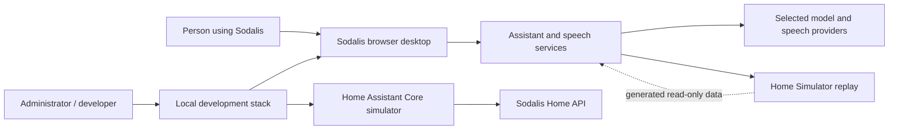
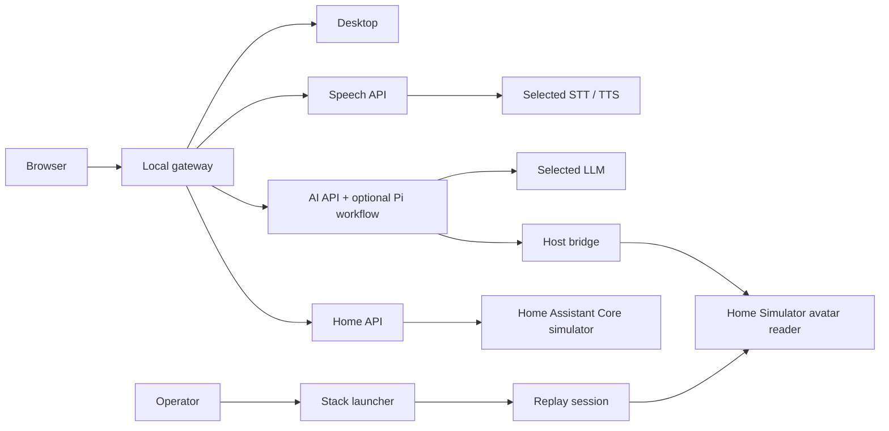
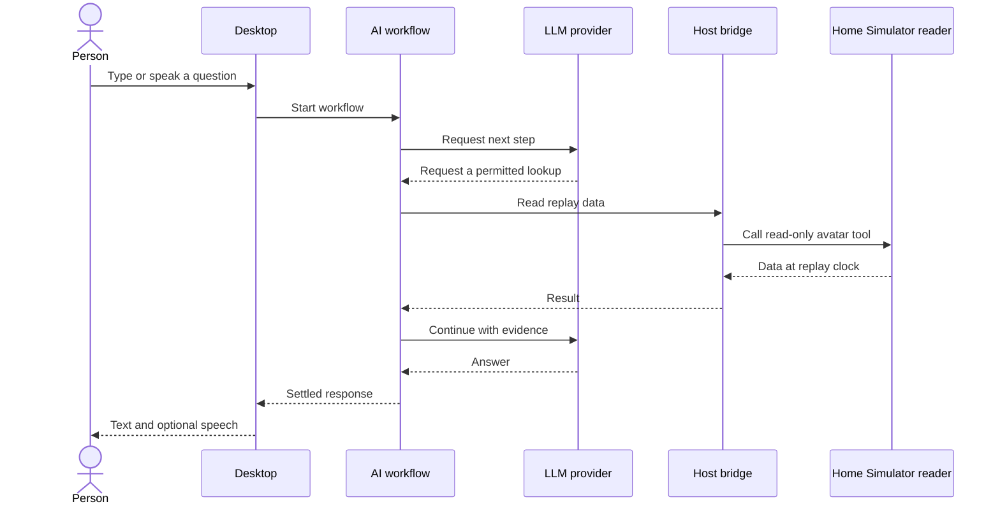
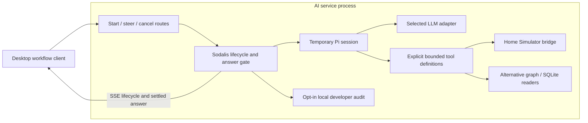
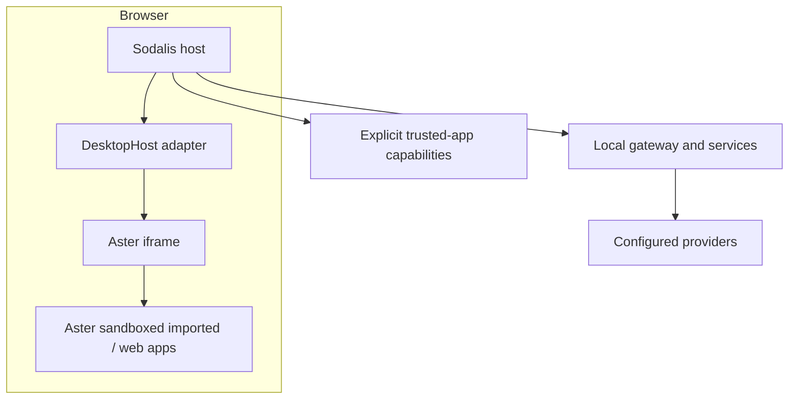

# System architecture

This page describes the implemented research prototype and its important
boundaries. It is not a production deployment specification. Detailed
decisions and limitations are linked below; proposed future integrations are
not represented as existing connections.

## System context

The person interacts with the desktop and assistant; an administrator starts
and configures the stack. Providers may be local or explicitly selected
external services. The Home Simulator replay supplies generated data to the
companion workflow. The separate Home Assistant Core simulator is reachable
through the typed Home API; the replay is not a live Home Assistant source.
Neither simulator is a connection to a real home.

## Local deployment

The gateway is the only normally published Compose service and binds to
localhost by default. AI and speech are separate services; provider engines
may run in containers, on the host, or externally when explicitly selected.
The host bridge is development-only, unauthenticated, and bound to a private
interface; it must not be exposed publicly. The separately owned simulator
checkout runs on the host. The launcher creates the replay session; the
operator advances it. The bridge exposes only the reader's curated tools.

The current simulator selection starts both simulator paths. See
[ADR 0009](https://github.com/TNO/sodalis/blob/main/docs/adr/0009-home-simulator-host-bridge.md)
and the [stack reference](https://github.com/TNO/sodalis/blob/main/docs/development-stack.md#home-simulator-replay-data)
for networking, lifecycle, and security details.

## Conversation and replay

This shows one possible workflow, not a guarantee that the model will call a
tool or answer correctly. Speech input and output pass through the speech API.
The replay starts before its first observation; the operator, not the
assistant, advances it. Five curated tools read sensor data, context,
ontology, weather, and agenda. The assistant cannot change replay state.

The regular **turn mode** and Pi **workflow mode** are different execution
paths within AI. Turn mode supports trusted desktop actions and optional
consent-governed memory. Workflow mode performs read-only investigations and
does not currently provide desktop actions or long-term memory.

## Companion harness (provisional)

The companion harness connects reasoning to evidence. A household question
may require several related lookups, with each result shaping what the
assistant needs to investigate next. Rather than prescribe a fixed sequence,
the harness supports that adaptive investigation while keeping its authority
within explicit limits. Its design is evolving as the prototype develops.

Pi provides the model/tool loop inside the AI service. Sodalis owns the
surrounding lifecycle, permitted capabilities, and answer delivery. This
separation allows the reasoning engine and model provider to evolve without
giving the model control over its own permissions. The harness is not a
separate deployed service or a general-purpose coding agent.

The architecture separates five responsibilities:

| Responsibility | Design role |
| --- | --- |
| Reasoning and context | Pi works with the selected model, the companion's instructions, and bounded conversation context. A temporary session holds the investigation's working state, not long-term personal memory. |
| Evidence access | Sodalis-defined tools expose only approved sources and bounded results. Information returned by a source cannot grant new capabilities. |
| Lifecycle | Sodalis controls how an investigation starts, responds to changed input, and ends or is cancelled. Execution limits keep work bounded. |
| Answer delivery | The host distinguishes intermediate investigation from a settled answer, so tool narration is not mistaken for a response to the person. |
| Diagnostics | A separate, opt-in local developer audit supports inspection of the workflow. Diagnostic persistence is distinct from assistant memory. |

For the simulated home, evidence comes through the read-only replay bridge.
The graph and configured-reading path is an alternative source arrangement,
not a second source automatically combined with the replay. This keeps source
integration separate from the reasoning loop and from authority to change a
home or application.

Embedding Pi shares the AI process's permissions and failure domain:
**it is not an operating-system sandbox**. The existing desktop, confirmation,
and consent boundaries still apply. The current workflow is read-only and
does not include desktop actions or long-term memory. A future unified
assistant would bring those capabilities together while preserving their
distinct permission and consent requirements.

The [decision summary](./decisions.md#companion-orchestration-and-simulator-access)
explains the trade-offs. The
[detailed companion reference](https://github.com/TNO/sodalis/blob/main/docs/architecture/companion-harness.md)
documents current runtime behavior, and
[future work](../guide/future-work.md#companion-reliability-and-convergence)
describes the broader ambition.

## Trust boundaries

Aster remains in its iframe, with its own sandbox for imported and web apps.
`packages/desktop-host` is the narrow integration boundary; it does not expose
Aster's DOM, imported content, or arbitrary globals to the assistant. Trusted
applications can expose explicit semantic capabilities separately. External
effects and destructive actions require code-enforced confirmation where
supported. Provider selection can send conversation, audio, or generated text
outside the machine; local-first is a preference, not a guarantee for every
configuration.

See [ADR 0003](https://github.com/TNO/sodalis/blob/main/docs/adr/0003-trusted-desktop-boundary.md),
the [desktop foundation](https://github.com/TNO/sodalis/blob/main/docs/architecture/desktop-foundation.md),
and [memory decision](https://github.com/TNO/sodalis/blob/main/docs/adr/0005-long-term-memory.md).

## Why these boundaries?

See the [key decisions and evidence](./decisions.md) for a concise account of
the major trade-offs, considered alternatives, and evaluation limits.
The [future-work index](../guide/future-work.md) separates remaining engineering
from research opportunities and explicitly deferred directions.
