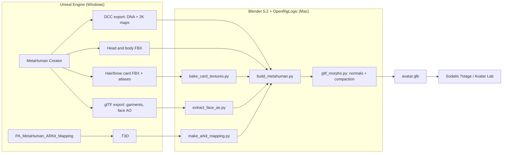

# Converting a MetaHuman into a Sodalis avatar

This tutorial turns a character made in MetaHuman Creator into a single GLB file
that Sodalis (TalkingHead 1.7) can animate. The GLB has the 52 ARKit face
shapes, the 15 Oculus visemes, eye bones and a Mixamo/Ready Player Me
skeleton. It works for any MetaHuman. **Anna**, a 30-year-old woman with a
short layered bob, crop top, jeans and sneakers, is the worked example
throughout ([TASKS/0054](../../TASKS/0054-evaluate-metahuman-avatar.md)).


> **Licence.** MetaHumans fall under the Unreal Engine EULA. Converted
> avatars are for evaluation in Sodalis and must not be redistributed.
> Never commit MetaHuman exports, DNA files, textures, the ARKit mapping
> derived from Epic's pose asset, or the resulting GLB. The repository
> ignores `apps/desktop/public/avatars/eval/` for that reason. The scripts in
> `tools/avatar-authoring/metahuman/` are ours and contain no Epic content.

## Why not Unreal's own glTF export?

Unreal can export a MetaHuman straight to glTF, but the result is not a
TalkingHead avatar. With UE 5.8.3 we found:

| Problem | Effect |
| --- | --- |
| 856 morph targets named `target_0…855`, all FACS correctives | No ARKit or viseme names. The face is driven by joints that RigLogic moves, and glTF cannot run RigLogic. |
| Skin weights are corrupt (`WEIGHTS_n` hold small integers that don't sum to 1; left/right mixed) | The mesh tears as soon as a bone moves. The outfit fitting settings are not the cause. |
| Five duplicated skeletons (342 and 875 joints), MetaHuman bone names | Needs conversion to `Hips`/`Spine`/… anyway. |
| Eyelash material has no texture and alpha 0; eye shell is opaque black | Invisible lashes and black eyes, also with *Export Thin Translucent Materials* on. |
| Grooms (hair, brows) are not exported | Bald. |
| Body under the outfit is removed | The body only works with that outfit. |
| "4K" maps (with a 4096 bake size) are upscaled from lower-resolution bakes | 8× bigger file, 3–6× less fine detail than the DCC maps. |

So the face and body come from the **DCC export + DNA + FBX**, and the face
shapes are baked by evaluating the character's own RigLogic rig. Unreal's
glTF export is still useful as a source of **garments** (meshes and textures)
and of the baked **face ambient-occlusion** map.

## Overview



| Stage | Where | Time |
| --- | --- | --- |
| A. Create and export | Unreal 5.6+ with the MetaHuman plugin | 30–60 min |
| B. One-time Mac setup | Blender 5.2, OpenRigLogic | 15 min |
| C. Prepare inputs | Python scripts | 5 min |
| D. Build | Blender, headless | about 35 s |
| E. Install and check | Sodalis dev server | 10 min |

## Part A — Unreal: create and export

Unreal runs on Windows here (more disk space); Part B onwards runs on a Mac.
The menus below were checked with UE 5.8.3. Names can move between versions.

### A1. Create the character

Make the MetaHuman in Creator. A few settings matter for the conversion:

- **Hair and eyebrows.** Choose groom styles that also ship **card**
  meshes; the conversion uses the cards, not the strands. Write down the
  groom colours. The card export has no colour map, so you recreate the
  colours in step C2.

  

- **Outfit.** Garments only reach Sodalis through the glTF export. Keep the
  default skin-weight fixes on (*Prune*, *Relax*, *Hammer*, *Clamp*,
  *Normalize*). They are not what corrupts the glTF weights; the
  conversion recomputes the weights anyway.

  

- **Makeup.** A no-makeup texture set works best. Dark eyeshadow baked into
  the face colour reads as "double eyes" in a browser and makes closed lids
  look bruised. Apply makeup in Creator only if you want it in the avatar.

- **Preview.** Keep *Grooms* and *Outfit Clothing* set to *Visible* and the
  face and body on the *Idle* template, so the export captures the
  character as you see it.

  

### A2. Exports to make

Put everything for one character in one folder, e.g.
`~/avatar-work/<name>/`.

| Export | How | Used for |
| --- | --- | --- |
| **DCC export** (zip) | Creator: *Export > DCC Export*. Do it once without makeup. | `head.dna`, `body.dna`, `Maps/*.png` (2K): head, body, teeth, eyes, eyelashes |
| **Head and body FBX** | Content Browser: right-click the face and body skeletal meshes > *Asset Actions > Export* > FBX | Meshes, skin weights and skeleton. Unreal exports them at 0.01 scale with intermediate empties; the build fixes both. |
| **Hair and eyebrow cards** | The groom's `*_CardsMesh_Group0_LOD0` static mesh > *Export* > FBX, and the `*_CardsAtlas_Attribute` texture > *Export* > PNG | Hair and brows |
| **ARKit mapping** | Content Browser, *Settings > Show Plugin Content*, find `PA_MetaHuman_ARKit_Mapping` (MetaHuman plugin), right-click > *Asset Actions > Export* > `.T3D` | Which rig controls make each ARKit shape |
| **glTF export** (optional) | Place the MetaHuman in a level, select it, *File > Export Selected* > `.glb`, settings below | Garments; face ambient occlusion |

The glTF export settings that worked for Anna:


- *Export Uniform Scale* 0.01, so the export is in metres.
- *Default Material Bake Size* 1024 with *Auto-detect* gives 2K garment maps
  where the source has them. Don't force 4096: it upscales (see the table
  above) and the GLB grows from about 0.9 GB to 1.1 GB.
- *Export Morph Targets* and *Export Vertex Skin Weights* can stay on; the
  conversion uses neither.
- *Export Thin Translucent Materials* does not repair the lashes.

The "Materials Export" of the unbaked material inputs (`T_Face_*`,
`T_Body_*`) gives real 4096 px face maps with the DCC head's UVs. For Anna
they were indistinguishable from 2K in Face framing, and the body colour is an
untinted layer that Unreal tints in its shader. They are not needed.

## Part B — Mac: one-time setup

1. **Blender 5.2** (tested 5.2.2 LTS) on your `PATH` as `blender`. It
   bundles Python 3.13 and numpy.
2. **OpenRigLogic** (MIT), Epic's open-source RigLogic with Python bindings,
   built for Blender's Python:

   ```bash
   brew install cmake swig
   uv python install 3.13      # same minor version as Blender's Python
   tools/avatar-authoring/metahuman/build_openriglogic.sh   # installs to ~/avatar-work/tools/openriglogic
   ```

   The script pins upstream commit `9ca65ac` (RigLogic 13.5.0) and applies
   [`openriglogic-macos.patch`](../../tools/avatar-authoring/metahuman/openriglogic-macos.patch):
   it links the Python *module* target instead of libpython (Blender embeds
   its own), and renames a macro for SWIG 4.5. It then adds `.so` links, an
   `@loader_path` rpath and an ad-hoc signature, and checks that Blender can
   `import dna, riglogic`. If you install elsewhere, set `OPENRIGLOGIC_LIB`
   to the `lib` folder.
3. **Pillow** for the card-texture baker: any Python 3 venv with `numpy` and
   `pillow`.

## Part C — Prepare the inputs

Unzip the DCC export (Anna: `~/avatar-work/anna/dcc-nomakeup/`). The build
expects in its `Maps` folder: `Head_Basecolor`, `Head_Normal`, `Head_SRMF`,
`Body_Basecolor`, `Body_Normal`, `Body_SRMF`, `Teeth_Color`, `Teeth_Normal`,
`Eyes_Color`, `Eyes_Normal` and `Eyelashes_Color` (`.png`).

### C1. ARKit mapping

```bash
python3 tools/avatar-authoring/metahuman/make_arkit_mapping.py \
  PA_MetaHuman_ARKit_Mapping.T3D ~/avatar-work/anna/arkit_mapping.json
```

Each ARKit pose becomes additive `CTRL_expressions_*` weights relative to the
pose asset's *Default* pose. The same file works for every MetaHuman of that
Unreal version, but keep it out of git: it is derived from an Epic asset.
`mouthClose` is derived from the lips-together pose; `tongueRollDown` has no
pose in the asset. The 15 visemes come from our own
[`visemes.json`](../../tools/avatar-authoring/metahuman/visemes.json), which
combines rig controls by hand.

### C2. Hair and brow colour textures

Unreal colours grooms in its shader from the attribute atlas
(R = coverage, G = per-strand seed, B = root→tip). Bake a colour + alpha
texture, using the colours you noted in Creator:

```bash
python bake_card_textures.py hair  Hair_S_BobLayered_CardsAtlas_Attribute.PNG \
  ~/avatar-work/anna/hair/Hair_BaseAlpha.png --root 1a100a --tip 4f3423 --gain 4
python bake_card_textures.py brows Eyebrows_L_Shaded_CardsAtlas_Attribute.PNG \
  ~/avatar-work/anna/hair/Brows_BaseAlpha.png --root 180f0a --tip 3a281c --gain 16
```

`--gain` scales the coverage into alpha; thin brow strands need more.

### C3. Face ambient occlusion (optional)

If you made the glTF export, copy its baked face occlusion map next to the
DCC maps. The build uses it when it is there:

```bash
python3 tools/avatar-authoring/metahuman/extract_face_ao.py \
  AnnaExportTest_v2.glb ~/avatar-work/anna/dcc-nomakeup/Maps/Head_Occlusion.png
```

### C4. Character config

Copy [`characters/anna.json`](../../tools/avatar-authoring/metahuman/characters/anna.json)
and edit the paths. Relative paths resolve from the config file; `~` is
expanded.

| Key | Required | Meaning |
| --- | --- | --- |
| `name`, `id` | yes | Material/mesh prefix; skeleton name and default output file |
| `head_fbx`, `body_fbx`, `dna`, `maps` | yes | Part A exports (`dna` is the head DNA) |
| `recipes` | yes | `visemes.json` and your `arkit_mapping.json` |
| `face.lash_alpha_gain` | no (1.8) | Multiplies lash alpha after growing the strands 1 px |
| `face.lid_follow` | no (0.35) | How much the lids follow the eyes in `eyeLook*` shapes |
| `face.rest_lid_lift` | no (0.7) | Fraction of the character's own `eyeWide` baked into the rest pose |
| `hair.FBX`, `hair.BASE`, `hair.SCALP_OUT` | with hair | Card FBX, baked texture, output for the scalp-tinted head colour |
| `hair.HAIR_OFFSET`, `VOLUME_SIDE`, `VOLUME_CROWN`, `SCALP_TINT` | no | Hair placement (m), volume lift at tips/crown, root colour (sRGB 0–1) |
| `brows.FBX`, `brows.TEX`, `brows.BROW_OFFSET` | with brows | Brow cards, texture, offset (m). Brows need hair: they reuse its fit. |
| `outfit.glb`, `outfit.garments` | no | Unreal glTF export, and `{glTF mesh name: new mesh name}` for each garment |
| `texture_cap` | no (2048) | Largest texture side; Sodalis recommends at most 2048 |

To find the garment mesh names, open the glTF in Blender or read its JSON
`meshes[].name` (Anna: `MHC_Anna_Outfits`, `_2`, `_3`).

## Part D — Build

```bash
cd ~/avatar-work/anna
blender -b -noaudio --python-exit-code 1 \
  --python <repo>/tools/avatar-authoring/metahuman/build_metahuman.py -- \
  --config <repo>/tools/avatar-authoring/metahuman/characters/anna.json \
  --out out/anna.glb --blend out/anna.blend
```

It ends with `METAHUMAN_EXPORTED <path> <bytes>`. Anna takes about 35 s and
gives a 39 MB GLB. `--blend` saves the scene for inspection; the GLB is the
only artefact Sodalis needs. Blender's FBX importer prints
`Error, could not find any file path in FBXElem(... EnvSamplerTex ...)` for
Unreal's environment-sampler textures. These are harmless; real failures
stop the build with a traceback and a non-zero exit code.

What the build does:

1. **Imports** the head and body FBX. It applies Unreal's 0.01 scale and
   moves the vertex groups of helper empties to real bones.
2. **Bakes the face** (`rigbake.py`). It evaluates RigLogic from the DNA for
   each ARKit pose and viseme, and writes the resulting joint motion and
   correctives as shape keys on the head. DNA LOD0 holds the head, teeth,
   saliva, eyeLeft, eyeRight, eyeshell, eyelashes, eyeEdge and cartilage
   meshes in that order; the mapping is by vertex index, so the bake runs
   before any topology change.
3. **Face clean-up.** Drops the saliva, eyeEdge and cartilage meshes. Keeps
   the eyeshell as a soft eye-occlusion layer with a generated alpha mask.
   Scales the lid motion in `eyeLook*` shapes to `lid_follow`. Opens the
   rest lids by `rest_lid_lift`. Softens the lash alpha.
4. **Skeleton.** Moves the head onto the body skeleton, renames bones to
   Mixamo/Ready Player Me names, adds `LeftEye`/`RightEye`/`HeadTop_End`, and
   aligns the rest frames to TalkingHead's.
5. **Hair and brows** (`hair.py`, `brows.py`). Unreal binds grooms with an
   RBF warp that cannot be exported. The build fits the card roots to the
   scalp (scale + translation), adds volume and pushes cards out of the
   skin. Brow cards are wrapped onto the skin and take its weights and shape
   keys, so they follow raises and frowns.
6. **Outfit** (`add_metahuman_outfit.py`). Keeps only the listed garments and
   their materials, aligns them to the body, and re-transfers skin weights
   from the body and head. It hides body skin under the garments: skin that
   fabric touches, or that a short ray along its normal hits fabric from.
   Body skin is never hidden by distance alone, which would remove a bare
   belly between top and jeans.
7. **Export** (`build_avatar.export_glb`) with morph normals, then
   **post-process** (`gltf_morphs.py`): repairs fold normals and stores morph
   targets sparsely (see the eyelid observation below).

## Part E — Install and check in Sodalis

```bash
cp out/anna.glb <repo>/apps/desktop/public/avatars/eval/anna-eval.glb
VITE_SODALIS_EVAL_AVATARS=1 pnpm --filter @sodalis/desktop dev
# open http://localhost:5173/?stage&avatar=metahuman-anna-eval
```

Evaluation avatars are listed in `EVALUATION_CANDIDATES` in
`apps/desktop/src/avatar/defaultAvatar.ts` and only load in development
with that flag. For a new character, add an entry with its id, GLB path,
attribution and `behavior.poseScale`.

Check:

- **Avatar Lab validator**: `valid: true`. A MetaHuman with an outfit gives
  one warning, about 190k triangles over the 100k recommended. That is
  expected: the head alone is Unreal's LOD0.
- **Framing**: walk through Face, Head, Head & Shoulders, Bust, Half Body,
  Three-Quarter and Full Body. Look at the hairline, the neck seam between
  head and body, and the collar.
- **Eyes**: open, mid-blink, closed, and looking up/down/left/right.
- **Speech**: *Say it* with the on-device voice for visemes; then the idle
  poses for a minute for body motion.

## Observations and troubleshooting

### Closed eyelids: dark band, then a dark slit


1. **Dark band** (top). glTF morph targets without NORMAL deltas keep
   rest-pose normals. The closed upper lid uses skin that faces down into
   the crease at rest, so it shades dark. Exporting morph normals fixes the
   band, but the GLB grew from 41 MB to 65 MB.
2. **Thin dark slit** (middle). At rest, the skin inside the upper-lid crease
   is hidden, and its exported normals point *into* the fold (z ≈ −0.17
   where the surface faces +0.88). A blink pulls that skin out. Every other
   active morph (squint, look down, which TalkingHead holds at idle) adds its
   delta to that wrong base normal. An unlit render showed no line, so the
   geometry was fine. Smoothing or "unfolding" the shape keys in Blender did
   not help and collapsed the lid into the eyeball.
3. **Fix** (bottom), in `gltf_morphs.py` after export:
   - Base normals that disagree with the welded, area-weighted geometric
     rest normal are blended toward it. Normals that agree are kept.
   - Morph normal deltas are recomputed by rotating the repaired normal with
     the change of the geometric normal, smoothed over 3 vertex rings.
   - All targets are then stored sparsely, keeping deltas above 0.02 mm and
     about 0.5°. The GLB went from 65.5 MB to **39.4 MB** with morph
     normals included.

The same issue can appear in any deep fold that a shape opens (lips,
nasolabial crease). The post-process handles every primitive with morph
targets.

### Eyes look sleepy or follow the gaze too much

TalkingHead holds `eyeBlink` near 0.1 at idle, with a little squint and a
downward gaze. A MetaHuman's neutral upper lid already covers the top of the
iris, so together this looks sleepy. `rest_lid_lift` 0.7 bakes 70% of the
character's own `eyeWide` into the rest pose; blinks still close fully. In
the RigLogic poses, the lids follow `eyeLookDown` by about 16 mm, compared
with about 5 mm for a Ready Player Me avatar. `lid_follow` 0.35 scales that
down.

### Eyelashes

The DCC lash cards have strands of 1–2 px of alpha. With an alpha cutoff
they vanish in mipmaps and leave clumps and specks. The build grows the
strands by 1 px, multiplies alpha by `lash_alpha_gain`, and exports the lashes
as alpha `BLEND`. The glTF export's lash material cannot help: it has no
texture.

### Wrinkle maps

The DCC and Materials exports include animated colour (`CM1–3`) and normal
(`WM1–3`) wrinkle maps. Unreal blends them per face region, with masks,
driven by rig controls in a custom shader. glTF materials cannot express
that, so they are not used.

### Texture resolution

The DCC maps are 2048 px. "4K" packs are worth checking with `magick
identify` or `sips -g pixelWidth`. Packs named 4K have turned out to be 2K,
and glTF bakes at 4096 have turned out to be upscaled. Real 4K face maps
(Materials Export) looked the same as 2K in Face framing, so ship 2K.

### Body and outfit

- The head mesh reaches the collarbones and can show through a high collar.
  Garments take weights from the nearer of body and head, and are kept at
  least 3 mm off the head.
- Body skin is hidden under garments, like Unreal's hidden-surface removal,
  so the body doesn't poke through in poses. The outfit was tested in 11
  poses (reach up, sit, deep knee, twist and others).
- The FBX body has no garment. Without an `outfit` section the character is
  in Unreal's default underwear from the body texture.

### Idle body motion

TalkingHead's neutral idle switches between `side`, `hip` and `straight`
poses. On a realistic body the `hip` pose looks exaggerated. Set
`behavior.poseScale` (Anna: 0.35) in the avatar entry to blend the idle poses
toward `straight`.

## Files

| File | Purpose |
| --- | --- |
| `tools/avatar-authoring/metahuman/build_metahuman.py` | Main build, run in Blender |
| `.../characters/<name>.json` | Per-character config |
| `.../rigbake.py` | RigLogic evaluation and shape-key baking |
| `.../visemes.json` | Viseme recipes in rig controls |
| `.../make_arkit_mapping.py` | T3D pose asset → `arkit_mapping.json` |
| `.../bake_card_textures.py` | Hair/brow colour textures from the attribute atlas |
| `.../extract_face_ao.py` | Face occlusion from Unreal's glTF |
| `.../hair.py`, `brows.py`, `add_metahuman_outfit.py` | Hair, brows, garments |
| `.../build_openriglogic.sh`, `openriglogic-macos.patch` | OpenRigLogic build |
| `tools/avatar-authoring/build_avatar.py` | Shared skeleton alignment, texture cap and GLB export |
| `tools/avatar-authoring/gltf_morphs.py` | Fold-normal repair and sparse morph targets |
