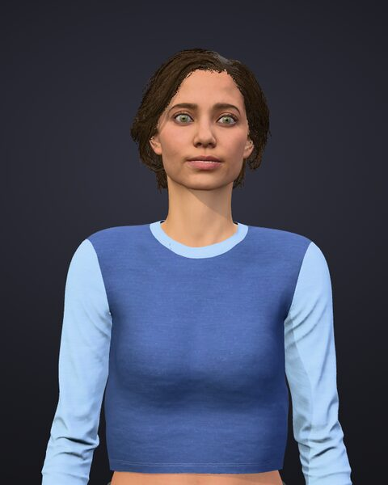
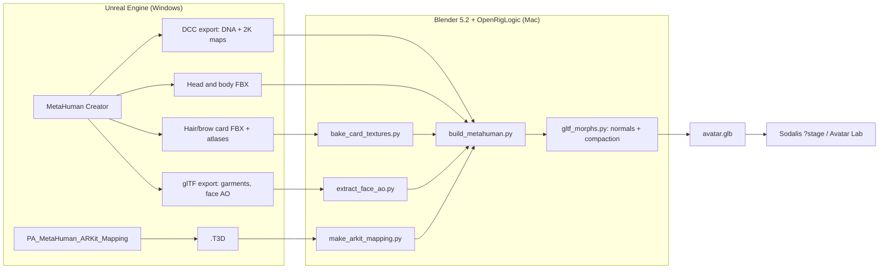
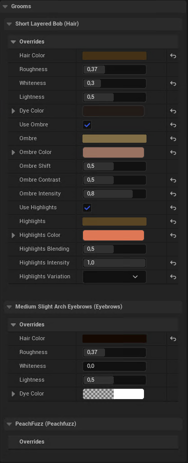
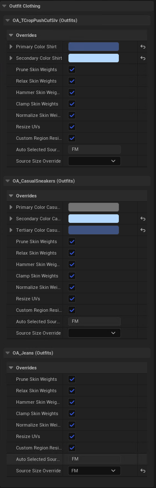
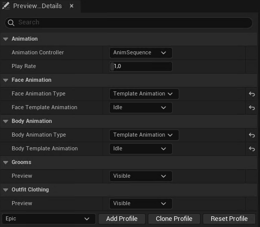
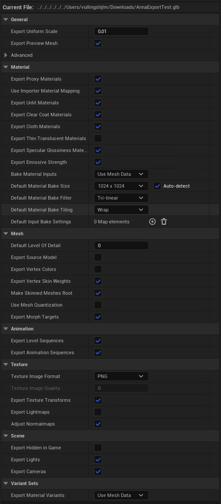
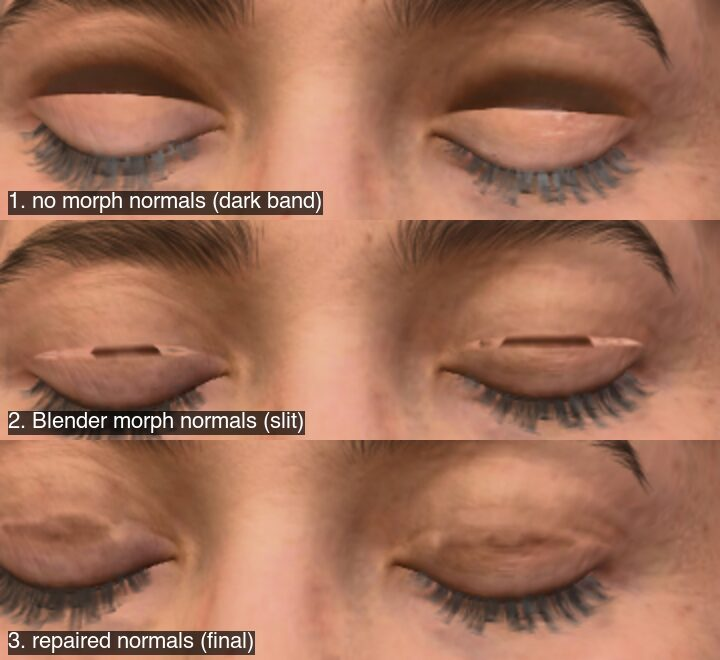

# Converting a MetaHuman into a Sodalis avatar

This tutorial turns a character made in MetaHuman Creator into a single GLB file
that Sodalis (TalkingHead 1.7) can animate. The GLB has the 52 ARKit face
shapes, the 15 Oculus visemes, eye bones and a Mixamo/Ready Player Me
skeleton. It is a workflow for **new** MetaHumans, not a recipe for
recreating Anna. Anna is the only character tested end to end so far and is
used only as the example
([TASKS/0054](../../TASKS/0054-evaluate-metahuman-avatar.md)). Use `<name>`
for a lowercase character folder/id (Anna: `anna`), `<MHC>` for its Unreal
MetaHuman Character asset (Anna: `MHC_Anna`), and `<repo>` for your Sodalis
checkout. Replace these placeholders in commands and filenames.



> **Licence.** MetaHumans fall under the Unreal Engine EULA. Converted
> avatars are for evaluation in Sodalis and must not be redistributed.
> Never commit MetaHuman exports, DNA files, textures, the ARKit mapping
> derived from Epic's pose asset, or the resulting GLB. The repository
> ignores `apps/desktop/public/avatars/eval/` for that reason. The scripts in
> `tools/avatar-authoring/metahuman/` are ours and contain no Epic content.

## Next-character checklist

After the one-time setup in A0 and B:

1. In Creator (A1), select skin, card-capable hair and brows, optional
   garments; record groom colours. Rig, download texture sources, assemble.
2. Export DCC ZIP, head/body FBX, and hair/brow card FBX + attribute PNG
   (A2). Export the ARKit mapping once per Unreal version. Export a GLB
   only when you need garments or the optional face AO.
3. Check and transfer the files in A3, prepare textures and config in C,
   build in D, then inspect in E.

## Why not Unreal's own glTF export?

Unreal can export a MetaHuman straight to glTF, but the result is not a
TalkingHead avatar. With UE 5.8.3 we found:

| Problem | Effect |
| --- | --- |
| 856 morph targets named `target_0…855`, all FACS correctives | No ARKit or viseme names. The face is driven by joints that RigLogic moves, and glTF cannot run RigLogic. |
| Skin weights are corrupt (`WEIGHTS_n` hold small integers that don't sum to 1; left/right mixed) | The mesh tears as soon as a bone moves. The outfit fitting settings are not the cause. |
| Five duplicated skeletons (342 and 875 joints), MetaHuman bone names | Needs conversion to `Hips`/`Spine`/… anyway. |
| Eyelash material has no texture and alpha 0; eye shell is opaque black | Invisible lashes and black eyes, also with *Export Thin Translucent Materials* on. |
| Grooms (hair, brows) are not exported | Bald. |
| Body under the outfit is removed | The body only works with that outfit. |
| "4K" maps (with a 4096 bake size) are upscaled from lower-resolution bakes | 8× bigger file, 3–6× less fine detail than the DCC maps. |

So the face and body come from the **DCC export + DNA + FBX**, and the face
shapes are baked by evaluating the character's own RigLogic rig. Unreal's
glTF export is still useful as a source of **garments** (meshes and textures)
and of the baked **face ambient-occlusion** map.

## Overview



| Stage | Where | Time |
| --- | --- | --- |
| A. Create and export | Unreal 5.6+ with the MetaHuman plugin (tested 5.8.3) | Allow extra time for first-time downloads |
| B. One-time Mac setup | Blender 5.2, OpenRigLogic | 15 min |
| C. Prepare inputs | Python scripts | 5 min |
| D. Build | Blender, headless | about 35 s |
| E. Install and check | Sodalis dev server | 10 min |

## Part A — Unreal: create and export

Unreal runs on Windows here (more disk space); Part B onwards runs on a Mac.
The menus below were checked with UE 5.8.3. Names can move between versions.
If a label differs, use the search box in the panel or menu you are in; the
instructions name the panel so you know where to search.

### Finding your way in the Unreal Editor

| Part of the editor | Where it is | How to open it if it is missing |
| --- | --- | --- |
| **Main menu** (*File*, *Edit*, *Window*, *Tools*, *Help*) | Top-left of the main editor window | Always visible |
| **Viewport** | The large 3D view in the middle | *Window > Viewports > Viewport 1* |
| **Outliner** | Top-right; lists actors placed in the open level | *Window > Outliner > Outliner 1* |
| **Details** | Right, below the Outliner; settings of the selected item | *Window > Details > Details 1* |
| **Content Drawer / Content Browser** | Bottom-left button *Content Drawer*, or `Ctrl+Space`; shows project files (assets) | *Window > Content Browser > Content Browser 1* opens a docked copy |

In the Content Browser, the **folder tree** is on the left, the **asset
grid** in the middle, the **Search** box above the grid, and **Settings**
(gear icon) at the top-right of the browser. *Right-click* an asset for its
context menu; *double-click* it to open it in its own editor tab. Hover an
asset to see its full name and type.

### A0. One-time Unreal setup

1. **Install Unreal.** Open **Epic Games Launcher**, sign in, then select
   *Unreal Engine* in the left sidebar and the **Library** tab at the top.
   Next to *ENGINE VERSIONS*, click **+**, choose the version (5.8.3 was
   tested), and click **Install**. Before or after installation, click the
   small arrow next to that engine's *Launch* button and choose
   **Options**; tick **MetaHuman Creator Core Data**, then **Apply**. Stay
   signed in: full rig creation and texture synthesis use Epic's online
   services.
2. **Create a project.** In the Launcher, click **Launch** on that engine.
   In *Unreal Project Browser*, choose **Games > Blank**, select
   *Blueprint*, choose a local folder with plenty of free space, enter a
   project name, and click **Create**. Avoid cloud-synced folders: MetaHuman
   downloads are large.
3. **Enable plugins.** In the main editor, choose **Edit > Plugins**. Use
   the search box at the top of the Plugins window:
   - Search `MetaHuman Creator`; tick **MetaHuman Creator**.
   - If you will export clothing, search `glTF` and tick **glTF Exporter**.
   - Do not enable the experimental *MetaHuman Creator - UAF support* plugin;
     this workflow does not need it.
   Click **Restart Now** when Unreal asks, or close and reopen the project.
4. **Show plugin content.** Open the **Content Drawer** (bottom-left, or
   `Ctrl+Space`). Click its **Settings** gear at the top-right and turn on
   **Show Plugin Content**. A *Plugins* section appears in the folder tree.
   This is needed to find the ARKit mapping and groom card assets.
5. **Get the character.** For a Fab character, open **Window > Fab** in the
   main editor (or the Fab button in the toolbar, if shown), sign in, find the
   listing in **My Library**, and choose **Add to Project**. Wait for the
   download notification in the bottom-right. Then find its
   **MetaHuman Character** asset in the Content Browser; its icon/tooltip
   says *MetaHuman Character*. For a new character, use the next section.

### A1. Create and assemble a character

The **Creator** is the editor tab that opens when you double-click a
MetaHuman Character asset. Its category buttons run down the **left edge**,
the character preview is in the middle, and the selected category's settings
are on the **right**. Exact category names can differ by version; if a step
names a setting you cannot see, click through the left-edge categories or
use the right panel's search box.

1. **Create or open `<MHC>`.** In the Content Drawer, open a folder such as
   *Content*, right-click empty space in the asset grid, and search the menu
   for **MetaHuman Character**. Create it, type `<MHC>` (for example
   `MHC_Odette`) and press `Enter`. Double-click it to open Creator. For a
   Fab character, double-click its existing MetaHuman Character asset
   instead. Edit face, body and skin only if needed.
2. **Choose card-capable hair and brows.** Open the left-edge hair/groom
   category (*Hair and Clothing* or *Grooms*). Select hair and eyebrow
   styles that offer **cards**, not only strands. In the right panel, click
   each **Hair Color** swatch and record its **Melanin** and **Redness**
   values for hair and brows in `groom-colours.txt`. Also record whether
   *Use Ombre* is enabled and any other active colour effects. This
   MetaHuman picker does **not** provide Hex sRGB: C2 needs separately
   chosen hex colours to approximate the appearance, because the card
   atlas has coverage but no baked colour. After assembly, confirm the
   styles have
   `*_CardsMesh_Group0_LOD0` assets; otherwise select a style with cards.
   Anna used `Hair_S_BobLayered` and `Eyebrows_L_Shaded`.

   

3. **Add clothing if wanted.** In the clothing/outfit category, choose the
   outfit. Fab outfits are Chaos Outfit assets; the DCC export does **not**
   contain them, so you will need the optional GLB in A2.5. Keep the default
   fitting/skin-weight fixes (*Prune*, *Relax*, *Hammer*, *Clamp*,
   *Normalize*); the converter transfers garment weights from the FBX body.
   Record any custom garment colours, which the GLB bakes.

   

4. **Check preview settings.** Decide whether to bake makeup into the
   exported skin. For Anna, no makeup avoided dark eyelids; makeup is a
   character choice, not a pipeline requirement. In the right panel's
   *Preview* settings, keep *Grooms* and *Outfit Clothing* **Visible**, and
   face/body on *Idle*.

   

5. **Rig and download textures.** When appearance is final, click
   **Create Full Rig** in Creator's toolbar or rig category. Wait for the
   progress notification in the bottom-right. Then click **Download Texture
   Sources** (in the skin/material category or the same rig/texture
   controls). Rigging locks some face/body texture controls behind a warning;
   if you need to change them, remove the rig, edit, then rig again.
6. **Assemble.** Click the left-edge **Assembly** category. Choose
   **UE Cine** to retain high-detail LOD0 meshes, then click
   **Assemble**. If choosing **UE Optimized**, verify the exported FBXs
   still contain LOD0 before building. The tested example used standard,
   non-UAF output. Assembly creates a character Blueprint (`BP_...`) and
   skeletal meshes; the MetaHuman Character asset itself can be elsewhere
   in *Content*, and DCC Export alone does not create these assembled
   assets. Note the output folder shown by Assembly rather than assuming
   it matches the Character asset's folder. Assembly is distinct from
   **DCC Export**; in UE 5.8 DCC Export moved to the *Export* category.
   After later Creator edits, assemble again before exporting from the
   project. Then choose **File > Save All** in the main editor.

### A2. Exports to make

Keep one folder per character on Windows, e.g. `Downloads\<name>\`, with
these inputs for the hand-off in A3. Names in screenshots are **Anna
examples**; use the assets belonging to your `<MHC>` and its chosen grooms.

#### A2.1 DCC ZIP (required)

In Creator, click the left-edge **Export** category, then **DCC Export**
(in older versions, look in *Assembly*). Save the downloaded ZIP as
`<MHC>_DCC.zip` in the character folder. In Windows File Explorer,
right-click the ZIP, choose **Extract All…**, and confirm it includes
`head.dna`, `body.dna`, and `Maps/Head_Basecolor.png` plus body, teeth,
eyes and eyelash maps. **DCC Export has no 4K setting.** Check the
dimensions of `Maps/Head_Basecolor.png` (right-click > *Properties* >
*Details*), not a 1024 px preview image; Anna's actual maps were 2048 px.
Keep the ZIP or its extracted contents outside git.

#### A2.2 Head and body FBX (required)

1. First complete **Assembly** in A1. The DCC ZIP does not make the mesh
   assets appear in the Content Browser. Open the Content Drawer, select
   *Content* in its left tree and clear any text in the search field above
   that tree (for example `Texture`) and the asset-grid Search field.
   Remove any active type filters using the **Filter** button beside the
   asset-grid Search field.
2. Open the folder reported by Assembly (often under *Content >
   MetaHumans*). If you cannot find it, search from *Content* for the new
   `BP_` Blueprint with your character's name; right-click it and choose
   **Show in Folder View** to locate the assembled output. If no Blueprint
   appears, return to the Character asset (which may be directly under
   *Content*) and check that Assembly finished successfully.
3. In the assembled output, use the **Filter** button and choose
   **Skeletal Mesh** if the folder is busy. Hover candidates to identify
   the assembled **face/head** and **body** meshes; they may be in a
   subfolder rather than beside the Blueprint. Do not choose the Blueprint,
   a Skeleton, a Physics Asset, or a Groom.
4. Right-click the face mesh, choose **Asset Actions > Export…**, select
   **FBX** as the file type, and save `<MHC>_Head.FBX`. Accept the default
   FBX export options unless they disable mesh LODs. Repeat for the body,
   saving `<MHC>_Body.FBX`.

The Blender build selects LOD0 and fixes Unreal's 0.01-scale FBX hierarchy.

#### A2.3 Hair and brow cards (for a character with hair/brows)

For **each selected groom** (normally one hair and one brow groom):

1. Search the Content Drawer for the groom style name you selected, for
   example `BobLayered` or `Eyebrows_L_Shaded`. *Show Plugin Content* must
   be on. If several match, right-click the selected groom and choose
   **Reference Viewer** to see linked assets.
2. Find the **Static Mesh** whose name ends in
   `_CardsMesh_Group0_LOD0`. Right-click it, choose **Asset Actions >
   Export…**, select **FBX**, and save it with the same name. Long hair
   styles can split their cards over several groups: also export every
   `_CardsMesh_Group1_LOD0`, `_Group2_LOD0`, … that exists, and list them
   all in `hair.FBX`. A missing group leaves part of the head bald (see
   *Bald back of the head*). The `_CardsAtlas_Tangent` texture is not
   needed: it only steers Unreal's strand shading.

   To see which groups and atlases exist:

   1. In the Content Drawer, double-click the **Groom** asset: it has a
      pink icon and the type *Groom*, not a CardsMesh. The Groom editor
      opens.
   2. In the row of icon tabs at the top of its Details panel, click the
      **Cards** tab (hover over the icons to see their names). It shows
      a list of coloured bars: **Cards 0**, **Cards 1**, **Cards 2**, …
   3. Each bar is one card group **at one level of detail**, not one
      group. Below each bar, read **Group Index** (the group) and
      **LODIndex** (0 = full detail). Scroll down to see all bars. Only
      entries with **LODIndex 0** matter; export one
      `_CardsMesh_Group<N>_LOD0` for each distinct Group Index. The
      **Mesh** field shows the asset name.
   4. To see the atlas, click the small **▸** next to **Textures** under
      a LODIndex 0 entry, then hover over the **Attribute** slot (or open
      its dropdown) to read the texture name. If every group uses the
      same `_CardsAtlas_Attribute`, export it once (step 3). Export any
      other Attribute texture the same way.
3. Find the **Texture** whose name ends in `_CardsAtlas_Attribute`.
   Right-click it, choose **Asset Actions > Export…**, choose **PNG** in the
   *Save as type* list, and save it with the same name.

The hair and brow atlases are different. Do not export lash cards: the
build uses the DCC eyelashes.

#### A2.4 ARKit mapping (once per Unreal version)

With *Show Plugin Content* enabled, type `PA_MetaHuman_ARKit_Mapping` in
the Content Drawer's Search box. If nothing appears, select *Plugins* in the
folder tree first, then search again. Right-click the pose asset, choose
**Asset Actions > Export…**, and save the `.T3D` outside the per-character
folder, e.g. in `Downloads\metahuman-shared\`. C1 converts it once; reuse
the mapping for characters built with that version. Keep this Epic-derived
data out of git.

#### A2.5 GLB (only for garments or optional face AO)

1. In the main editor, choose **File > New Level…**, select **Basic**, and
   click **Create**. Then choose **File > Save Current Level As…** and save
   it, for example as `<name>_Export`. An **Empty** level has no lights; in
   *Lit* view the character may show only an outline while *Unlit* still
   shows it.
2. In the Content Drawer, locate the assembled character Blueprint (`BP_...`)
   as in A2.2, and drag it (not the MetaHuman Character asset) into the
   Viewport. In the **Outliner** (top-right), click only that actor; do not
   hold `Ctrl` or select lights or the floor. Choose **File > Save All**
   before exporting: GLTFExporter crashed once during the Anna evaluation.
3. Choose **File > Export Selected…**. In the save dialog, set *Save as
   type* to **glTF binary (`.glb`)**, enter `<name>Export.glb`, and click
   **Save**. In the export options window, use:

   

   - *Export Uniform Scale*: **0.01** (metres).
   - *Default Material Bake Size*: **1024** with *Auto-detect*, as in the
     tested export. Inspect the resulting maps rather than assuming
     Auto-detect guarantees a size. Forcing 4096 upscaled Anna's bakes and
     inflated the GLB.
   - Disable *Export Lights* and *Export Cameras*. Morph targets and skin
     weights are not used from the GLB for the face/body. *Export Thin
     Translucent Materials* did not fix Anna's black eye shell or lashes.
   - Click **Export** and wait until the notification disappears.

Warnings about `-1` indices, near-zero normals/tangents and Eye or
Subsurface materials becoming *Default Lit* did not prevent garment
extraction in Anna's case. If the editor crashes, reopen the saved level
and retry; if the exported garments are broken, investigate rather than
ignoring new warnings.

### A3. Handoff checklist

Keep the **actual files**, not only Unreal asset references. Copy this
folder to the Mac; substitute your character's and grooms' names:

```text
~/avatar-work/
  shared/
    PA_MetaHuman_ARKit_Mapping.T3D       # once per Unreal version
    arkit_mapping.json                   # generated in C1
  <name>/
    unreal/
      <MHC>_DCC.zip                      # or extracted dcc/ below
      <MHC>_Head.FBX
      <MHC>_Body.FBX
      <HairGroom>_CardsMesh_Group0_LOD0.FBX   # plus Group1, … if they exist
      <HairGroom>_CardsAtlas_Attribute.PNG
      <BrowGroom>_CardsMesh_Group0_LOD0.FBX
      <BrowGroom>_CardsAtlas_Attribute.PNG
      <name>Export.glb                   # only when needed
      groom-colours.txt                  # groom picker values; chosen bake hex colours
    dcc/                                 # extracted ZIP: head.dna, Maps/, ...
    hair/                                # generated in C2
    out/                                 # generated in D
```

Before leaving Unreal, confirm the two body/face FBXs and, for each groom
used, its card FBX, attribute PNG and recorded colours. Check the real DCC map dimensions and the
optional GLB's garments. Copy only assets selected for this character;
shared/unused outfits (`Khaos*`, `RomanticCasual*` in Anna's project),
underwear variants and animated wrinkle maps are not separate required
inputs. `CombinedSkelMesh` references are body assets, **not garments**.
The optional **Materials Export** gave Anna real 4K inputs, but those had
no visible benefit in the Face evaluation and its untinted body colour
needs Unreal's shader: start with the DCC maps, not 220 material textures.

| Unreal symptom | Next step |
| --- | --- |
| Rig warning blocks skin controls | Remove the rig to change textures; re-rig and reassemble. |
| DCC Export absent from Assembly | In UE 5.8, find it in **Export**. |
| Pose mapping or groom cards not found | Enable **Show Plugin Content**; check the selected groom has cards. |
| Visible in Unlit but not Lit | Use a **Basic** level with lighting. |
| GLB misses character | Select **only** `BP_<MHC>` before Export Selected. |
| ZIP previews show 1024 px | Inspect `Maps/Head_Basecolor.png` instead. |

## Part B — Mac: one-time setup

1. **Blender 5.2** (tested 5.2.2 LTS) on your `PATH` as `blender`. It
   bundles Python 3.13 and numpy.
2. **OpenRigLogic** (MIT), Epic's open-source RigLogic with Python bindings,
   built for Blender's Python:

   ```bash
   brew install cmake swig
   uv python install 3.13      # same minor version as Blender's Python
   tools/avatar-authoring/metahuman/build_openriglogic.sh   # installs to ~/avatar-work/tools/openriglogic
   ```

   The script pins upstream commit `9ca65ac` (RigLogic 13.5.0) and applies
   [`openriglogic-macos.patch`](../../tools/avatar-authoring/metahuman/openriglogic-macos.patch):
   it links the Python *module* target instead of libpython (Blender embeds
   its own), and renames a macro for SWIG 4.5. It then adds `.so` links, an
   `@loader_path` rpath and an ad-hoc signature, and checks that Blender can
   `import dna, riglogic`. If you install elsewhere, set `OPENRIGLOGIC_LIB`
   to the `lib` folder.
3. **Pillow** for the card-texture baker: any Python 3 venv with `numpy` and
   `pillow`.

## Part C — Prepare the inputs

Extract the DCC ZIP into `~/avatar-work/<name>/dcc/`. Ensure the **actual**
`head.dna` and `Maps/` directory are directly inside `dcc/` (some unzip
tools introduce an extra parent directory). The build expects in `Maps/`:
`Head_Basecolor`, `Head_Normal`, `Head_SRMF`, `Body_Basecolor`,
`Body_Normal`, `Body_SRMF`, `Teeth_Color`, `Teeth_Normal`, `Eyes_Color`,
`Eyes_Normal` and `Eyelashes_Color` (`.png`).

### C1. ARKit mapping (once per Unreal version)

```bash
python3 <repo>/tools/avatar-authoring/metahuman/make_arkit_mapping.py \
  ~/avatar-work/shared/PA_MetaHuman_ARKit_Mapping.T3D \
  ~/avatar-work/shared/arkit_mapping.json
```

Each ARKit pose becomes additive `CTRL_expressions_*` weights relative to the
pose asset's *Default* pose. The same file works for every MetaHuman of that
Unreal version, but keep it out of git: it is derived from an Epic asset.
`mouthClose` is derived from the lips-together pose; `tongueRollDown` has no
pose in the asset. The 15 visemes come from our own
[`visemes.json`](../../tools/avatar-authoring/metahuman/visemes.json), which
combines rig controls by hand. It also defines four optional detail visemes
for Azure's finer phoneme groups: `viseme_AX` (schwa), `viseme_OW` (closed
rounded o), `viseme_ER` (r-coloured vowel) and `viseme_HH` (breathy h/g).
Avatars without them still work: the runtime folds each one into its core
viseme (AX→aa, OW→O, ER→RR, HH→kk).

### C2. Hair and brow colour textures

Unreal colours grooms in its shader from the attribute atlas
(R = coverage, G = per-strand seed, B = root→tip). Creator's **Hair Color**
picker exposes Melanin and Redness, not Hex sRGB; there is no exact hex
value to copy from it. Choose initial hex sRGB root/tip colours to match the
appearance in Unreal and record them in `unreal/groom-colours.txt`. With
*Use Ombre* disabled, start with the same root and tip colour. Bake a
colour + alpha texture, preview it in Sodalis, and adjust the colours
if needed rather than treating a screenshot sample as an exact conversion.
From the character folder (`~/avatar-work/<name>/`), run:

```bash
mkdir -p hair
python3 <repo>/tools/avatar-authoring/metahuman/bake_card_textures.py hair \
  unreal/<HairGroom>_CardsAtlas_Attribute.PNG hair/Hair_BaseAlpha.png \
  --root <hair-root-hex> --tip <hair-tip-hex> --gain 4
python3 <repo>/tools/avatar-authoring/metahuman/bake_card_textures.py brows \
  unreal/<BrowGroom>_CardsAtlas_Attribute.PNG hair/Brows_BaseAlpha.png \
  --root <brow-root-hex> --tip <brow-tip-hex> --gain 16
```

`--gain` scales coverage into alpha; thin brow strands need more. For
Anna, hair used `1a100a`/`4f3423` and brows `180f0a`/`3a281c`. For Odette's
near-black hair (Melanin 0.81, Redness 0.37), hair used `0d0907`/`110c09`
and brows `140e0a`/`140e0a`, chosen by eye against her Unreal render.

### C3. Face ambient occlusion (optional)

If you made the glTF export, copy its baked face occlusion map next to the
DCC maps. The build uses it when it is there:

```bash
uv run -q --with pillow python <repo>/tools/avatar-authoring/metahuman/extract_face_ao.py \
  unreal/<name>Export.glb dcc/Maps/Head_Occlusion.png
```

The script bakes the material's `KHR_texture_transform` into the image (see
"Baked textures carry a UV transform" below). It prints the transform it
applied.

### C4. Character config

Copy [`characters/anna.json`](../../tools/avatar-authoring/metahuman/characters/anna.json)
to `~/avatar-work/<name>/character.json` as a **template**. Change `name`,
`id`, and every Anna-specific path to this character's `unreal/`, `dcc/`,
`hair/` and the shared mapping. In `recipes`, use the absolute path to
`<repo>/tools/avatar-authoring/metahuman/visemes.json` and
`~/avatar-work/shared/arkit_mapping.json`; the original `../visemes.json`
path only works when the config is beside the example file. Relative paths
resolve from the config file; `~` is expanded. Delete the `outfit` section
if you did not export garments, and remove `hair`/`brows` sections if they
do not apply.

| Key | Required | Meaning |
| --- | --- | --- |
| `name`, `id` | yes | Material/mesh prefix; skeleton name and default output file |
| `head_fbx`, `body_fbx`, `dna`, `maps` | yes | Part A exports (`dna` is the head DNA) |
| `recipes` | yes | `visemes.json` and your `arkit_mapping.json` |
| `face.lash_alpha_gain` | no (1.8) | Multiplies lash alpha after growing the strands 1 px |
| `face.lid_follow` | no (0.35) | How much the lids follow the eyes in `eyeLook*` shapes |
| `face.rest_lid_lift` | no (0.7) | Fraction of the character's own `eyeWide` baked into the rest pose |
| `hair.FBX`, `hair.BASE`, `hair.SCALP_OUT` | with hair | Card FBX (or a list, one per card group), baked texture, output for the scalp-tinted head colour |
| `hair.HAIR_OFFSET`, `VOLUME_SIDE`, `VOLUME_CROWN`, `SCALP_TINT` | no | Hair placement (m), volume lift at tips/crown, scalp colour (sRGB 0–1) |
| `hair.ROOT_FRAC`, `hair.FIT_SCALE` | no (0.15, fitted) | Fraction of each card treated as root when fitting to the scalp; fixed fit scale instead of a fitted one. Long hair: `0.05` and `1.0` |
| `hair.BACK_FILL`, `hair.BACK_FILL_MIN_SIDE` | no (off, 0.06) | Workaround for a missing back card group: copy the long side cards, rotated by these angles (degrees) towards the back. Only cards whose tips hang more than `MIN_SIDE` m beside the head are copied. Odette: `[35, 70, 105]` |
| `hair.DRAPE`, `DRAPE_STRAIGHTEN`, `DRAPE_FRONT`, `DRAPE_CLEARANCE`, `DRAPE_BEND`, `DRAPE_PIVOT`, `DRAPE_BLEND`, `DRAPE_BONE` | no (off, 0, 0, 0.012, 0.04, 0.12, 0.06, `Spine2`) | Lay long hair over the shoulders instead of through them. `STRAIGHTEN` (0–1) removes the groom's backward sweep below `PIVOT` m above the shoulder line, for front locks: cards whose tips then fall in front of the shoulders (+`FRONT` m). Cards are then bent clear of the body. Hair below the shoulders is skinned to `BONE`, blended over `BLEND` m. Odette: on, 1.0, 0.03, 0.02 |
| `hair.DRAPE_FRONT_ROOT`, `DRAPE_FRONT_PART`, `DRAPE_LEAN` | no (None, None, 0) | Pick front locks by root instead: cards rooted ahead of `FRONT_ROOT` (y, m). Cards rooted within `PART[0]` m of the parting must be rooted ahead of `PART[1]`, else they hang behind the neck. `LEAN` (dy/dz) tilts straightened front locks forward. Odette: 0.0, [0.04, −0.04], 0.25 |
| `hair.DRAPE_SIM_FRAMES`, `DRAPE_SIM_COMB`, `DRAPE_SIM_BACK`, `DRAPE_SIM_SLIDE`, other `DRAPE_SIM_*` | no (0 = off, 3.0, true, None) | After the outfit is added, settle the hair with a small strand simulation against the body and garments. `COMB` (m/s²) pushes front locks forward over the shoulders. `BACK` false keeps the back hair as `drape()` left it; simulated, it piles on the shoulders. `SLIDE` (m) stops side locks sliding round the front of the neck. Odette: 90, 8.0, false, 0.01 |
| `brows.FBX`, `brows.TEX`, `brows.BROW_OFFSET` | with brows | Brow cards, texture, offset (m). Brows need hair: they reuse its fit. |
| `brows.BROW_EYE_HEIGHT` | no | Mean brow height above the eye centres, in eye spacings (Anna measures 0.26). Replaces `BROW_OFFSET`'s vertical effect. |
| `outfit.glb`, `outfit.garments` | no | Unreal glTF export, and `{glTF mesh name: new mesh name}` for each garment |
| `outfit.tuck` | no | `{inner new name: outer new name}`: cut the inner garment where the outer covers it, e.g. `{"Blouse": "Jeans"}` |
| `outfit.textures` | no | `{new name: {"baseColor": PNG}}` replaces a garment's base colour (see "Blurred garment colour" below) |
| `texture_cap` | no (2048) | Largest texture side; Sodalis recommends at most 2048 |
| `map_overrides` | no | `{map name: PNG}` replacing a file in `maps`, e.g. `Eyes_Color` |

### C5. Eye colour from Unreal (recommended)

The DCC export's `Eyes_Color.png` is a generic, lighter iris without a limbal
ring, so the avatar's eyes look unlike the character in Unreal. Unreal's
glTF export (with baked materials) contains the real iris. Extract it,
bake its texture transform into the image and cap it at 2048 px:

```bash
uv run -q --with pillow python tools/avatar-authoring/metahuman/extract_glb_texture.py \
  --glb AnnaExportTest_v3.glb --material MI_EyeL_Baked_Face \
  --out ~/avatar-work/anna/maps-override/Eyes_Color.png
```

Then point `map_overrides.Eyes_Color` at the result. The build uses one eye
material for both eyes, so the left eye's texture is enough.

To find the garment mesh names, open the glTF in Blender or read its JSON
`meshes[].name` (Anna: `MHC_Anna_Outfits`, `_2`, `_3`).

`SCALP_TINT` is a starting colour, not a universal constant: Anna used
`[0.1647, 0.1098, 0.0784]` for dark brown hair. Start with the example's
fit offsets, then adjust for a different groom after inspecting the GLB.

## Part D — Build

```bash
cd ~/avatar-work/<name>
blender -b -noaudio --python-exit-code 1 \
  --python <repo>/tools/avatar-authoring/metahuman/build_metahuman.py -- \
  --config character.json --out out/<name>.glb --blend out/<name>.blend
```

It ends with `METAHUMAN_EXPORTED <path> <bytes>`. Anna took about 35 s and
gave a 39 MB GLB; new characters vary. `--blend` saves the scene for
inspection; the GLB is the only artefact Sodalis needs. Blender's FBX importer prints
`Error, could not find any file path in FBXElem(... EnvSamplerTex ...)` for
Unreal's environment-sampler textures. These are harmless; real failures
stop the build with a traceback and a non-zero exit code.

What the build does:

1. **Imports** the head and body FBX. It applies Unreal's 0.01 scale and
   moves the vertex groups of helper empties to real bones.
2. **Bakes the face** (`rigbake.py`). It evaluates RigLogic from the DNA for
   each ARKit pose and viseme, and writes the resulting joint motion and
   correctives as shape keys on the head. DNA LOD0 holds the head, teeth,
   saliva, eyeLeft, eyeRight, eyeshell, eyelashes, eyeEdge and cartilage
   meshes in that order; the mapping is by vertex index, so the bake runs
   before any topology change.
3. **Face clean-up.** Drops the saliva, eyeEdge and cartilage meshes. Keeps
   the eyeshell as a soft eye-occlusion layer with a generated alpha mask.
   Scales the lid motion in `eyeLook*` shapes to `lid_follow`. Opens the
   rest lids by `rest_lid_lift`. Softens the lash alpha.
4. **Skeleton.** Moves the head onto the body skeleton, renames bones to
   Mixamo/Ready Player Me names, adds `LeftEye`/`RightEye`/`HeadTop_End`, and
   aligns the rest frames to TalkingHead's.
5. **Hair and brows** (`hair.py`, `brows.py`). Unreal binds grooms with an
   RBF warp that cannot be exported. The build fits the card roots to the
   scalp (scale + translation), adds volume and pushes cards out of the
   skin. Brow cards are wrapped onto the skin and take its weights and shape
   keys, so they follow raises and frowns.
6. **Outfit** (`add_metahuman_outfit.py`). Keeps only the listed garments and
   their materials, aligns them to the body, and re-transfers skin weights
   from the body and head. It hides body skin under the garments: skin that
   fabric touches, or that a short ray along its normal hits fabric from.
   Body skin is never hidden by distance alone, which would remove a bare
   belly between top and jeans. Garments are not tested against each other:
   if a top shows through the jeans, list it in `outfit.tuck`. The build
   then deletes the top's faces that the jeans cover, keeping a 2 cm strip
   pushed just inside the waistband, so the top looks tucked in. Odette's
   log: `TUCK Blouse into Jeans: removed 4842 of 29286 faces, pushed 478
   verts inside`.
7. **Export** (`build_avatar.export_glb`) with morph normals, then
   **post-process** (`gltf_morphs.py`): repairs fold normals and stores morph
   targets sparsely (see the eyelid observation below).

## Part E — Install and check in Sodalis

Place the GLB in the git-ignored `apps/desktop/public/avatars/eval/` folder
as `<id>-eval.glb`, and add `metahumanEval("<id>", "<Name>")` to
`EVALUATION_CANDIDATES` in `apps/desktop/src/avatar/avatarCatalogue.ts`. That
registers `metahuman-<id>-eval` with `behavior.poseScale` 0.35,
`behavior.idleFaceScale` 0.3 and `lighting: "portrait"`; adjust the entry if
your character needs other settings. Anna and Odette are examples.
With `VITE_SODALIS_EVAL_AVATARS=1`, the entries appear in the assistant
panel's avatar choice and on the dev-only stage.

```bash
cp out/<name>.glb <repo>/apps/desktop/public/avatars/eval/<name>-eval.glb
VITE_SODALIS_EVAL_AVATARS=1 pnpm --filter @sodalis/desktop dev
# open http://localhost:5173/?stage&avatar=<registered-id>
```

To make an evaluation avatar the default on your machine, without
`?avatar=`, put this in the git-ignored `apps/desktop/.env.local` and restart
the dev server:

```bash
VITE_SODALIS_EVAL_AVATARS=1
VITE_SODALIS_DEFAULT_AVATAR=<registered-id>
```

The override applies to development builds only, until the user picks an
avatar (the choice is stored per device). An unknown id falls back to the
catalogue default.

Check:

- **Avatar Lab validator**: `valid: true`. A MetaHuman with an outfit gives
  one warning, about 190k triangles over the 100k recommended. That is
  expected: the head alone is Unreal's LOD0.
- **Framing**: walk through Face, Head, Head & Shoulders, Bust, Half Body,
  Three-Quarter and Full Body. Look at the hairline, the neck seam between
  head and body, and the collar.
- **Eyes**: open, mid-blink, closed, and looking up/down/left/right.
- **Speech**: *Say it* with the on-device voice for visemes; then the idle
  poses for a minute for body motion. *Say it* uses English text rules with
  estimated timing. For Dutch with real timing, record Azure clips with
  [`scripts/azure-visemes.py`](../../scripts/azure-visemes.py) (billed; get
  consent first). The stage then shows *Recorded Dutch*, which plays a clip
  with Azure's viseme track mapped to the 15 visemes plus the 4 detail
  visemes; the diphthongs (ids 9–11) glide between two shapes. Azure's ARKit
  blend-shape output is not available for nl-NL (viseme ids only).

## Observations and troubleshooting

### Closed eyelids: dark band, then a dark slit



1. **Dark band** (top). glTF morph targets without NORMAL deltas keep
   rest-pose normals. The closed upper lid uses skin that faces down into
   the crease at rest, so it shades dark. Exporting morph normals fixes the
   band, but the GLB grew from 41 MB to 65 MB.
2. **Thin dark slit** (middle). At rest, the skin inside the upper-lid crease
   is hidden, and its exported normals point *into* the fold (z ≈ −0.17
   where the surface faces +0.88). A blink pulls that skin out. Every other
   active morph (squint, look down, which TalkingHead holds at idle) adds its
   delta to that wrong base normal. An unlit render showed no line, so the
   geometry was fine. Smoothing or "unfolding" the shape keys in Blender did
   not help and collapsed the lid into the eyeball.
3. **Fix** (bottom), in `gltf_morphs.py` after export:
   - Base normals that disagree with the welded, area-weighted geometric
     rest normal are blended toward it. Normals that agree are kept.
   - Morph normal deltas are recomputed by rotating the repaired normal with
     the change of the geometric normal, smoothed over 3 vertex rings.
   - All targets are then stored sparsely, keeping deltas above 0.02 mm and
     about 0.5°. The GLB went from 65.5 MB to **39.4 MB** with morph
     normals included.

The same issue can appear in any deep fold that a shape opens (lips,
nasolabial crease). The post-process handles every primitive with morph
targets.

### Eyes look sleepy or follow the gaze too much

TalkingHead holds `eyeBlink` near 0.1 at idle, with a little squint and a
downward gaze. A MetaHuman's neutral upper lid already covers the top of the
iris, so together this looks sleepy. `rest_lid_lift` 0.7 bakes 70% of the
character's own `eyeWide` into the rest pose; blinks still close fully. In
the RigLogic poses, the lids follow `eyeLookDown` by about 16 mm, compared
with about 5 mm for a Ready Player Me avatar. `lid_follow` 0.35 scales that
down.

The right `rest_lid_lift` depends on the character. Odette's lids sit
higher than Anna's, so 0.7 made her look surprised; 0.35 matches her
reference render.

### Brows sink into the eyelids

If the brows look partly inside the head or hidden by the lashes, check
the `BROW_FIT` log line. The brow fit skips eyelid skin, so brows that
start over the upper lid snap to the lid edge and curl along the socket
(Odette: only 3191 of 5676 rays hit). Set `brows.BROW_EYE_HEIGHT` (start
at 0.26) and drop `BROW_OFFSET`; rayHits should then be close to 100%.
Brow colour: Odette's soft brown is `--root 2e2016 --tip 3a2a1e --gain 10`.

### Skin lacks the Creator makeup

The DCC `Head_Basecolor` has no Creator makeup (blush, eye shadow); only
Unreal's baked face texture has it, at 1024 px. Transfer its low-frequency
tone onto the 2048 px DCC map and add it to `map_overrides`:

```bash
uv run -q --with pillow --with numpy python <repo>/tools/avatar-authoring/metahuman/extract_glb_texture.py \
  --glb unreal/OdetteExport.glb --material MID_MI_Face_Skin_Baked_LOD0_VT_0_Face \
  --tone-onto <DCC>/Head_Basecolor.png --out maps-override/Head_Basecolor.png
```

`--tone-blur` (default 24 px) sets how much detail comes from the bake.
The stage lighting is brighter and cooler than Unreal's, so the skin will
not match a reference render exactly.

### Eyelashes

The DCC lash cards have strands of 1–2 px of alpha. With an alpha cutoff
they vanish in mipmaps and leave clumps and specks. The build grows the
strands by 1 px, multiplies alpha by `lash_alpha_gain`, and exports the lashes
as alpha `BLEND`. The glTF export's lash material cannot help: it has no
texture.

### Wrinkle maps

The DCC and Materials exports include animated colour (`CM1–3`) and normal
(`WM1–3`) wrinkle maps. Unreal blends them per face region, with masks,
driven by rig controls in a custom shader. glTF materials cannot express
that, so they are not used.

### Texture resolution

The DCC maps are 2048 px. "4K" packs are worth checking with `magick
identify` or `sips -g pixelWidth`. Packs named 4K have turned out to be 2K,
and glTF bakes at 4096 have turned out to be upscaled. Real 4K face maps
(Materials Export) looked the same as 2K in Face framing, so ship 2K.

### Baked textures carry a UV transform

Unreal's glTF export bakes face and eye materials into textures with a
`KHR_texture_transform` (Odette's face occlusion: scale 1.0057, 1.2220;
offset −0.0029, −0.0095). Applied to the DCC head UVs without that
transform, Odette's occlusion map drew dark creases across both cheeks;
Anna's smaller transform only shifted hers slightly. `extract_face_ao.py`
and `extract_glb_texture.py` bake the transform into the image. To find
which map causes an artefact, strip single maps from a copy of the GLB and
compare screenshots in Face framing.

### Long hair shrinks or shows the scalp

The fit matches card roots to the scalp. With `ROOT_FRAC` 0.15, roots of
long cards reached below the cranium, so the fit shrank Odette's hair to
0.89 and showed her scalp. `ROOT_FRAC` 0.05 with `FIT_SCALE` 1.0 gives the
same root error (3.9 mm) at full size. Check the `HAIR_FIT` log line: a
scale well below 1 points to this problem.

### Bald back of the head

Odette's export had only `Hair_L_Straight_CardsMesh_Group0_LOD0`: cards
covering the front and sides, 12.5 cm front to back on a 23 cm head. The
back of her head was bare and showed the scalp tint. Anna's bob is a single
group that covers the whole head. Compare the hair's front-to-back extent
with the head's (Blender: select both, read *Dimensions* Y in the N panel).
If it is much shorter, export the other card groups (A2.3) and list them
in `hair.FBX`.

`hair.BACK_FILL` is a stop-gap when you cannot export them: it copies the
long side curtains, rotates them towards the back, and moves each copy out
by the difference in skull radius so it keeps its stand-off from the skin.
The scalp tint then also covers the back of the cranium. The log reports
`HAIR_BACK_FILL cards=… verts a -> b`. Hair from the real groups looks
better, especially at the crown parting.

Unreal does not export every group in the same frame: Odette's Group0 is in
groom template space, but Group1 came out about 15 cm higher, roughly in
character space. The build therefore fits each group to the scalp
separately (`HAIR_GROUP … t=…` per group in the log); the brows reuse the
first group's fit, so list the group that shares the brows' frame first
(Group0). Group1 also had its atlas UVs in a channel named `LightMapUV`
instead of `UVmap_0`; the build uses UV channel 0 of every group,
whatever its name.

### Hard-edged shading band on a cheek

A faint, straight-edged darker band on one cheek, visible in Face framing,
was the **shadow of the hair cards** from the stage key light. three.js
shadow maps ignore the cards' alpha, so each card cast a solid shadow.
The stage no longer lets cutout or transparent materials (hair, brows,
lashes) cast shadows (`packages/avatar/src/scene/stageRealism.ts`).
To diagnose similar artefacts, hide meshes one at a time (A/B screenshots):
the band stayed without lashes and brows, but disappeared without the hair
or without the key-light shadow.

### Blurred garment colour

Unreal baked Odette's lace turtleneck to a blurred base colour; the lace
pattern survived only in the roughness texture's green channel. Rebuild
the base colour from it and set `outfit.textures`:

```bash
uv run -q --with pillow --with numpy python <repo>/tools/avatar-authoring/metahuman/extract_glb_texture.py \
  --glb unreal/OdetteExport.glb --material <garment material> \
  --detail-from-roughness 0.85 --out maps-override/Blouse_Basecolor.png
```

`K` (0–1) sets how strongly the roughness detail darkens the colour.

### Body and outfit

- The head mesh reaches the collarbones and can show through a high collar.
  Garments take weights from the nearer of body and head, and are kept at
  least 3 mm off the head.
- Body skin is hidden under garments, like Unreal's hidden-surface removal,
  so the body doesn't poke through in poses. The outfit was tested in 11
  poses (reach up, sit, deep knee, twist and others).
- The FBX body has no garment. Without an `outfit` section the character is
  in Unreal's default underwear from the body texture.

### Looks plainer than in Unreal

Measure before you tweak: on Odette, the head geometry and Unreal's baked
face texture matched ours. The differences were:

- **Lighting.** The default `studio` stage rig is bright and flat. MetaHuman
  entries use `lighting: "portrait"`: low ambient, fill and environment, so
  the key light models the face. Unreal's mauve lips came from its lighting
  and lip gloss, not from the texture.
- **Idle face drift.** TalkingHead adds random drift of up to 0.2 to 20
  morphs (`mtRandomized`), such as `noseSneer`, `cheekPuff` and
  `mouthRoll`. On RigLogic shapes that reads as a grimace.
  `behavior.idleFaceScale` (MetaHumans: 0.3) scales the drift.
- **Hair standing off the face.** `hair.VOLUME_SIDE` spreads the long side
  hair away from the cheeks, so it frames the face instead of falling
  along it. Lower it for long hair (Odette: 0.02). Pulling the curtains
  inward towards the skin does not work: push-out then wraps them around
  the cheekbones, leaving a visible step.
- **Hair colour.** Melanin 0.81 and redness 0.37 baked as near-black looked
  flat. Odette uses `--root 1c130d --tip 2c1f16`; `2b1d15`/`45301f` was
  too light (chestnut).
- **Wide eyes.** Lower `face.rest_lid_lift` (Odette: 0.15).
- **Head looks wider.** Horizontal slices of our head and Unreal's export
  matched to the millimetre. The impression came from hair standing off
  the face, cheek blush, flat lighting and hair hidden behind the shoulders.
- **Hair behind the shoulders.** The groom is authored swept back, and
  Unreal's hair physics drapes it forward. Without physics, a fifth of the
  long cards ended inside the blouse. Use `hair.DRAPE` with
  `DRAPE_SIM_FRAMES` (see the config table and Odette's values). Blender's
  cloth simulation on the hair cards was slow and unstable, hence the small
  built-in solver. Expect a narrower front curtain than Unreal's: the groom
  ends about 2 cm higher.

### Idle body motion

TalkingHead's neutral idle switches between `side`, `hip` and `straight`
poses. On a realistic body the `hip` pose looks exaggerated. Set
`behavior.poseScale` (Anna: 0.35) in the avatar entry to blend the idle poses
toward `straight`.

Close framings also suppress up/down head motion: TalkingHead's mood
animation and gaze randomly pitch the head, and breathing lifts it. Sodalis
scales these by framing: none in Face and Head, 35% in Head & shoulders and
Bust, full in wider framings. Yaw, roll, eye movement and nod gestures are
unaffected.

Sodalis's ambient sway is additive: each frame it removes its previous
offset and adds a new one on top of TalkingHead's current pose, and it fades
in and out over 0.6 s. An earlier version overwrote the hip and spine bones
with load-time rotations, which hid TalkingHead's pose until speech started
and then made the body snap.

### Lip-sync timing

Visemes are written to TalkingHead's `realtime` morph channel, not through
`setValue`. `setValue` uses acceleration-limited smoothing that lagged by
hundreds of milliseconds and kept the mouth moving after the target dropped.
Sodalis fades between viseme targets itself (80 ms by default). In a
headless capture of Dutch clip 01, mouth openness correlated 0.86 with the
Azure track (previously 0.71). The mouth now leads the audio by about 60 ms
instead of building up slowly. The system voice returns to idle on the
utterance's `end` event rather than after an estimated duration.

## Files

| File | Purpose |
| --- | --- |
| `tools/avatar-authoring/metahuman/build_metahuman.py` | Main build, run in Blender |
| `.../characters/<name>.json` | Per-character config |
| `.../rigbake.py` | RigLogic evaluation and shape-key baking |
| `.../visemes.json` | Viseme recipes in rig controls |
| `.../make_arkit_mapping.py` | T3D pose asset → `arkit_mapping.json` |
| `.../bake_card_textures.py` | Hair/brow colour textures from the attribute atlas |
| `.../extract_face_ao.py` | Face occlusion from Unreal's glTF |
| `.../extract_glb_texture.py` | One material texture (e.g. the iris) from Unreal's glTF |
| `.../hair.py`, `brows.py`, `add_metahuman_outfit.py` | Hair, brows, garments |
| `.../build_openriglogic.sh`, `openriglogic-macos.patch` | OpenRigLogic build |
| `tools/avatar-authoring/build_avatar.py` | Shared skeleton alignment, texture cap and GLB export |
| `tools/avatar-authoring/gltf_morphs.py` | Fold-normal repair and sparse morph targets |
