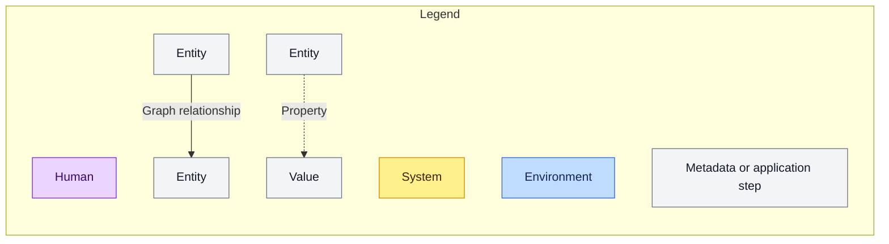
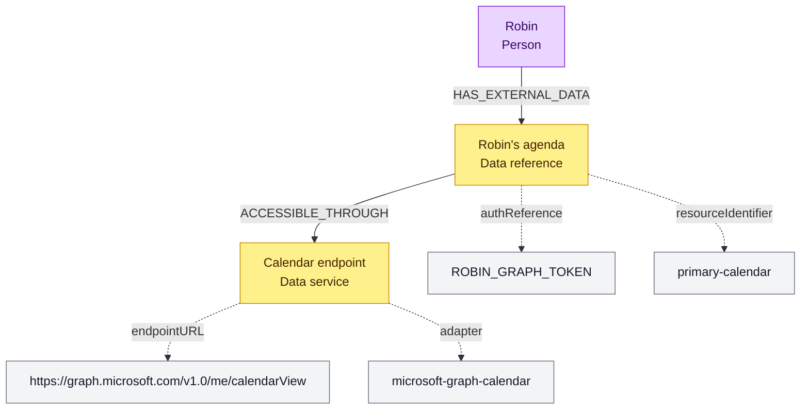
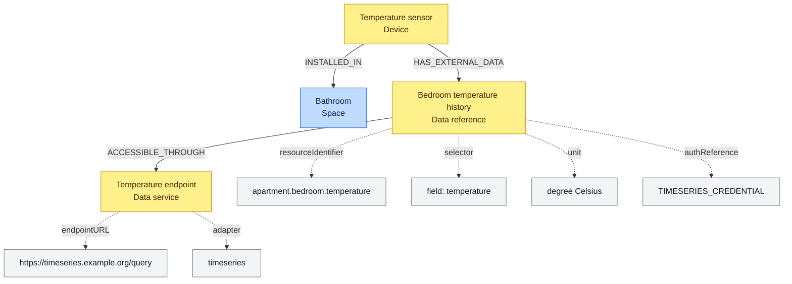
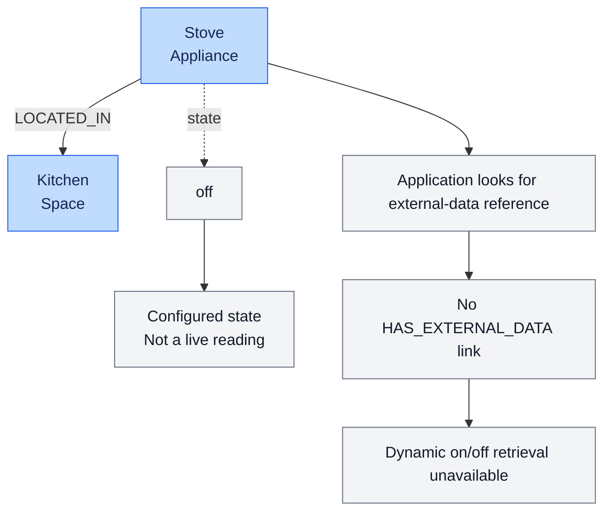

# Knowledge Graph Diagrams

Below is a legend followed by certain diagrams describing how to fetch (dynamic) information about the resident and its home through the knowledge graph.

Cypher queries are not included yet.

## Legend

## Getting Robins' Agenda

## Getting the temperature in the bedroom

## Getting information of a smart Kitchen Appliance

This is currently a feature that is not implemented yet. A stove is seen as a static thing, like a table, without any external data reference. Even the state is stored within the Knowledge graph. 

! Note, the storing of the state of an appliance within the knowledge graph should probably change, since we decided the knowledge graph should hold more "static" information.

